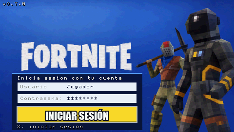
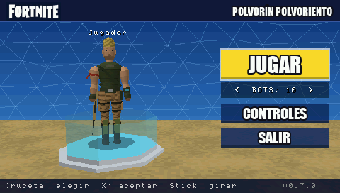
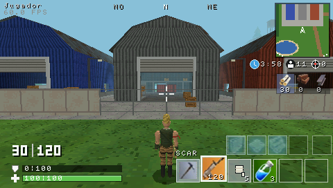
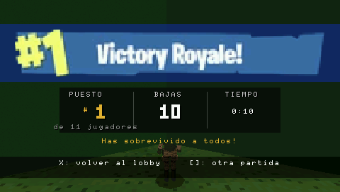
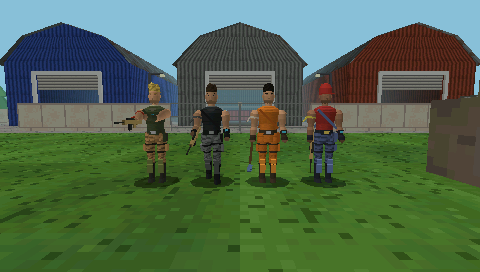

# FortnitePSP

Demake estilo PS1 de Fortnite para PSP, escrito en C++ sobre PSPSDK.

**Estado: fase 7, paso 1 (inventario, escudo, curas, pico y materiales) + personaje nuevo,
v0.7.1.** Se juega
una partida completa:
1. inicio de sesión;
2. lobby;
3. pantalla de carga;
4. battle royale contra 10 bots en el depósito "Polvorín", con disparos y construcción;
5. victoria o derrota;
6. vuelta al lobby u otra partida.






*Capturas de `make app-sim`: la aplicación real, dibujada por el rasterizador por software
de host. No son capturas de una PSP.*

## Qué incluye

**Fases 1–5:**
- **Base:** arranque y cierre seguros, GU con doble buffer y escenario 3D retro con
  niebla.
- **Jugador:** en tercera persona, con física en paso fijo de 1/60 s.
- **Mapa:** basado en las referencias, con colisiones AABB.
- **Bots:** IA de estados y navegación A*.
- **Combate:** SCAR legendaria con disparo desde la cámara y números de daño.
- **Construcción:** paredes de madera.

**Fase 6:**
- **Pantallas:**
  - **Inicio de sesión** al estilo de Fortnite (sobre `Recursos/loginscreen.png`).
  - **Lobby** como `Referencias/Lobby.png`: JUGAR, CONTROLES y SALIR; personaje que gira
    sobre su plataforma; número de bots.
  - **Carga**, **pausa** y **resultados** de victoria ("#1 Victory Royale!") y de
    derrota ("ELIMINADO"), con puesto, bajas, tiempo, quién te eliminó y la opción de
    seguir mirando.
- **HUD** según `Referencias/Referencia gameplay.png` y `Referencias/HUD/`:
  - minimapa con la zona y brújula;
  - vivos, bajas y tiempo de zona;
  - materiales y ranuras de construcción y de armas;
  - munición "30 | 120", escudo y vida;
  - rótulo de modo construcción.
- **Sonido:**
  - **Efectos:** disparos (con distancia y panorama), impactos, heridas, eliminaciones,
    paredes, recarga, menús, victoria y derrota.
  - **Música:** la del menú en los menús.
  - **Formatos:** WAV PCM e IMA ADPCM, con mezclador propio de 8 voces.
- **Aspecto retro:**
  - framebuffer de 16 bits con tramado;
  - 16 texturas originales de 32×32 con paleta reducida (`Recursos/Texturas/`);
  - niebla de distancia;
  - geometría low-poly coherente.
- **Animaciones:** respiración en reposo, retroceso al disparar, gesto al recibir un
  impacto y caída al ser eliminado.
- **Memoria y estabilidad:**
  - imágenes a 16 bits y atlas recortado: de ~2,6 MB a ~0,8 MB de RAM en interfaz;
  - registro de tiempos y heap de carga;
  - prueba de 10 partidas seguidas sin que crezca la memoria.

Detalle en [docs/PRESENTACION.md](docs/PRESENTACION.md).

**Fase 7, mejora del personaje** (detalle en [docs/JUGADOR.md](docs/JUGADOR.md#modelo-del-personaje-fase-7)):
deja de ser un conjunto de cajas.
- **Forma:** volúmenes redondeados con proporciones de Fortnite.
- **Articulaciones:** codos y rodillas.
- **Sombreado:** suave por vértice.
- **Textura:** sin filtrar (cara, camuflaje, pelo).
- **Rifle:** se sujeta con las dos manos al apuntar.
- **Nivel de detalle:** uno bajo para los bots lejanos.



**Fase 7, paso 1** (detalle en [docs/INVENTARIO.md](docs/INVENTARIO.md)):
- **Inventario:** 5 ranuras con armas y consumibles; la cruceta cambia de ranura.
- **Consumibles:** vendas, botiquín, minipoción y poción de escudo, con su tiempo de uso.
- **Escudo:** absorbe el daño antes que la vida.
- **Pico (TRIÁNGULO):** pica árboles, cajas, rocas y contenedores, que dan madera, piedra
  y metal. También golpea a los bots y a las paredes.
- **Coste de las paredes:** 10 de madera cada una.
- **Controles nuevos:** la cámara sigue al stick y L es el modo apuntado.
- **Sin cambios:** los bots, las colisiones y el disparo.

## Requisitos

- Toolchain [pspdev](https://github.com/pspdev/pspdev) (probado con el instalado en
  `~/pspdev`: GCC 15.2.0, pspsdk `6f15c15` del 2026-09-28).
- GNU Make (vale el 3.81 de macOS).
- **Opcional:**
  - Python 3 + Pillow + numpy y `afconvert` de macOS: solo para `make assets`. Los
    recursos ya convertidos están en `assets/`.
  - Compilador C++ de Xcode: solo para las herramientas de host (`app-sim`, `preview`,
    `physics-test`, `match-sim`).

El `Makefile` localiza el SDK por este orden: variable `PSPDEV`, `psp-config` en el
`PATH`, y por último `~/pspdev`. No hace falta tocar el `PATH`.

## Compilar

```sh
cd "/Users/mario/Documents/Fortnite PSP"
make && make release
```

- **`make`:** genera `EBOOT.PBP` en la raíz del proyecto (título en el XMB:
  **FortnitePSP**, `DISC_ID` `FNPS00001`, con `ICON0.PNG` y `PIC1.PNG` de la pantalla de
  carga).
- **`make release`:** lo copia a `build/PSP/GAME/FortnitePSP/EBOOT.PBP`.

| Comando             | Resultado                                                          |
|---------------------|--------------------------------------------------------------------|
| `make`              | Compila y empaqueta `EBOOT.PBP`                                    |
| `make release`      | Copia el EBOOT a `build/PSP/GAME/FortnitePSP/EBOOT.PBP`            |
| `make assets`       | Regenera `assets/` a partir de `Recursos/` (Python + Pillow)       |
| `make app-sim`      | La aplicación completa simulada en el Mac: menús, partidas, audio y capturas (`build/app_sim/`) |
| `make preview`      | Renderiza el mapa y los personajes por software en el Mac (`build/preview/`) |
| `make physics-test` | Pruebas de movimiento, salto, cámara y colisiones en el Mac        |
| `make match-sim`    | Partidas simuladas en el Mac: colisiones, disparos, IA, construcción y sucesos |
| `make clean`        | Borra objetos, `.elf`, `.prx`, `PARAM.SFO` y `EBOOT.PBP`           |
| `make distclean`    | `clean` + borra `build/`                                           |

### Instalar

- **PSP real (CFW):** copiar la carpeta `build/PSP/GAME/FortnitePSP/` a
  `ms0:/PSP/GAME/FortnitePSP/` de la Memory Stick.
- **PPSSPP:** abrir directamente `EBOOT.PBP`.

### Versiones funcionales guardadas

- **Git:** cada fase se cierra con un commit y una etiqueta (`v0.5.0`, `v0.6.0`), y dentro
  de la fase hay un commit por cada hito que compila y pasa las pruebas.
- **Copia del EBOOT:** el de cada versión se guarda en `releases/vX.Y.Z/EBOOT.PBP`. Esta
  carpeta no se sube a git.

### Registro de diagnóstico

En cada arranque se escribe `fortnitepsp_log.txt` en la misma carpeta que el EBOOT:
- **Carga:** cada paso, con su tiempo en ms y el heap en uso, y el tamaño de las imágenes
  y del audio.
- **Partida:** al empezar, el tiempo de preparación, el heap y su diferencia con el primer
  lobby. Al acabar, el ganador, el frame medio y el máximo, el coste de la IA, los
  disparos, las paredes, el heap y los sonidos perdidos.
- **Salida:** el motivo de salida.

## Controles

**Menús:**

| Pantalla          | Botón                  | Acción                                              |
|-------------------|------------------------|-----------------------------------------------------|
| Inicio de sesión  | **X**                  | Iniciar sesión (conexión simulada)                  |
| Lobby             | **Cruceta ↑ ↓**        | Elegir JUGAR / CONTROLES / SALIR                    |
| Lobby             | **Cruceta ← →**        | Sobre JUGAR: número de bots (5–30, por defecto 10)  |
| Lobby             | **X**                  | Aceptar (SALIR pide confirmación: X sale, O cancela)|
| Lobby             | **Stick**              | Girar el personaje                                  |
| Controles         | **O**                  | Volver al lobby                                     |
| Pausa             | **↑ ↓ + X**            | CONTINUAR / VOLVER AL LOBBY (START u O: continuar)  |
| Resultados        | **X**                  | Volver al lobby                                     |
| Resultados        | **CUADRADO**           | Otra partida                                        |
| Resultados (derrota) | **CÍRCULO**         | Seguir mirando hasta el final                       |
| Cualquiera        | **L + R + START 1 s**  | Salir del juego (vuelve al XMB)                     |

**Partida:**

| Modo          | Botón                                  | Acción                                       |
|---------------|----------------------------------------|----------------------------------------------|
| Siempre       | **Stick analógico**                    | Andar / correr; la cámara se coloca sola detrás (no al ir hacia atrás) |
| Siempre       | **X**                                  | Saltar (mantener = salto completo)           |
| Siempre       | **L (mantener)**                       | Apuntar: con un enemigo a la vista lo fija (el stick mueve de lado); sin él, el stick mueve la mira |
| Combate       | **Cruceta ← →**                        | Cambiar de ranura del inventario             |
| Combate       | **TRIÁNGULO**                          | Sacar / guardar el pico                      |
| Combate       | **R**                                  | Disparar (arma), golpear (pico, mantener) o usar (consumible) |
| Combate       | **CUADRADO**                           | Recargar                                     |
| Siempre       | **CÍRCULO**                            | **Modo construcción on/off**                 |
| Construcción  | **Cruceta ← →**                        | Elegir pieza (pared; suelo y rampa aún no)   |
| Construcción  | **R (pulsar)**                         | Colocar una pared delante (10 de madera)     |
| Construcción  | **CUADRADO**                           | Quitar la pared apuntada                     |
| Siempre       | **START**                              | Pausa                                        |
| Siempre       | **SELECT**                             | HUD: partida → depuración → controles → oculto |
| Depuración    | **TRIÁNGULO**                          | Cámara libre ↔ tercera persona (dentro: □ niebla, START VSync) |

Detalle en [docs/INVENTARIO.md](docs/INVENTARIO.md),
[docs/COMBATE_CONSTRUCCION.md](docs/COMBATE_CONSTRUCCION.md) y
[docs/JUGADOR.md](docs/JUGADOR.md).

## Limitaciones conocidas

- **v0.7.1 sin probar en ejecución real:** ni PPSSPP ni la PSP. Falta comprobar los FPS
  con el personaje nuevo y 30 bots: cada modelo cercano tiene 1292 triángulos y cada
  lejano 564, frente a 348 antes (ver la página de depuración).

  Según el usuario, en la PSP funcionan la v0.6.0 con 30 bots y la v0.7.0 (inventario,
  pico y cámara).
- **Inicio de sesión simulado:** no hay red, cuentas ni partidas online. El nombre es
  siempre "Jugador".
- **Botín pendiente (paso 2):** aún no hay cofres ni objetos en el suelo; se empieza con
  la SCAR, 5 vendas, 3 minipociones y 30 de madera. El botiquín y la poción de escudo
  existen, pero todavía no se consiguen.
- **Objetos agotados:** al picarlos no desaparecen. Las copas de los árboles no tienen
  colisión y la cámara puede quedar dentro de ellas.
- **Construcción:** solo funciona la pared; suelo y rampa se eligen con la cruceta, pero
  aún no se colocan. Piedra y metal se acumulan, pero aún no se usan.
- **Los bots** no usan pico, escudo ni consumibles.
- **Zona simplificada:** un círculo que se cierra en 4 min y guía a los bots hacia el
  depósito. Fuera de ella no se pierde vida. El reloj del HUD muestra lo que falta para
  que termine de cerrarse.
- **Bots:** 10 por defecto, configurables hasta 30. Todos llevan el mismo fusil.
- **Texto:** se usa la fuente 8×8 de depuración, sin tildes ni eñes (por eso se lee
  "Contrasena" o "elimino"). Los rótulos grandes (JUGAR, ELIMINADO…) sí las llevan,
  porque son imágenes.
- **Música:** solo en los menús; en la partida suenan solo los efectos.
  - El remuestreo es simple (vecino más cercano).
  - Los sonidos se oyen a través de las paredes, sin oclusión.
- **Espectador:** sigue a quien te eliminó o, si ya no está, al primer superviviente. No
  se puede cambiar de jugador.
- **Sin guardado:** no se guardan ajustes ni estadísticas entre sesiones.
- **Pantalla de carga:** dura como mínimo 2 s, aunque la partida esté lista antes, para
  que se pueda leer.
- **Salir:** con L+R+START. HOME lo gestiona el sistema.

## Estructura

```
Makefile                     Build basado en build.mak de PSPSDK
docs/PRESENTACION.md         Pantallas, HUD, estilo, animaciones, sonido, memoria (fase 6)
docs/INVENTARIO.md           Inventario, escudo, curas, pico y materiales (fase 7)
docs/MUNDO.md                Escala, ejes, plano del mapa, colisiones y texturas
docs/JUGADOR.md              Controles, movimiento, salto, paso fijo y cámara
docs/BOTS.md                 IA, disparos, partida, rendimiento y verificación
docs/COMBATE_CONSTRUCCION.md Arma, apuntado, paredes, controles y verificación
docs/capturas/               Capturas de app-sim y del previsualizador de host
src/
  main.cpp                   Módulo PSP, arranque, bucle principal y cierre
  app/app.*                  Ciclo de vida, partida, sucesos -> sonido, dibujo 3D
  app/app_menus.cpp          Inicio de sesión, lobby, controles, carga, pausa, resultados
  app/app_hud.cpp            HUD, minimapa, páginas de depuración y de controles
  app/lobby_scene.*          Escena 3D del lobby
  app/ui.*                   Atlas de interfaz (iconos, rótulos, banners)
  app/build_visuals.*        Paredes, pared fantasma y números grandes del HUD
  audio/                     Mezclador, WAV e IMA ADPCM, canal de pspaudiolib
  camera/                    Tercera persona (colisión, fijar objetivo) y cámara libre
  core/                      Configuración, temporizador, generador aleatorio
  game/                      Personajes, jugador, bots, partida y sucesos, arma, inventario, paredes, A*
  gfx/                       GU: estado 2D/3D, mallas, texturas, sprites, líneas, texto
  world/                     Mapa (visual + colisión), objetos recolectables, texturas, minimapa
  assets/                    Recursos incrustados (.incbin) y rectángulos del atlas
  input/ math/ platform/ third_party/
assets/                      Recursos convertidos (los genera make assets)
tools/app_sim/               La aplicación completa simulada (Mac)
tools/host/                  Rasterizador por software y recursos para las herramientas
tools/scene_preview/         Previsualizador por software (Mac)
tools/physics_test/          Pruebas de movimiento y colisión (Mac)
tools/match_sim/             Simulador de partidas (Mac)
tools/prepare_assets.py      Conversión Recursos/ -> assets/
tools/generate_*.py          Generadores de texturas, sonidos e iconos originales
Recursos/ Referencias/       Recursos directos / material de referencia
```

### Recursos y referencias

**`Recursos/`**, usados directamente en el juego:
- **Imágenes:**
  - `loginscreen.png`: pantalla de inicio de sesión.
  - `Loadscreen - match.png`: pantalla de carga, `PIC1.PNG` e `ICON0.PNG`.
  - `fortnite_PNG25.png`: logotipo del lobby.
  - `HUD/`: iconos de construcción (Pared, Suelo, Rampa, Pico), rótulo de victoria,
    materiales (`Wood_icon`, `stone_orig`, `Metal_icon`), ranura de la minipoción e
    iconos originales (vivos, bajas, zona, escudo, vida, vendas, botiquín y poción de
    escudo, de `tools/generate_hud.py`).
  - `Weapons/AssaultRiffleLegendary.png`: ranura de la SCAR en el HUD.
- **`Texturas/`:** 16 texturas originales de 32×32 (`tools/generate_textures.py`).
- **`Sonidos/`:**
  - efectos originales (`tools/generate_sounds.py`);
  - `main title song.wav`, la música del menú.

**`Referencias/`**, solo como guía:
- **Mapa:** "Polvorín Polvoriento".
- **Personaje:** el modelo.
- **Armas:** el color del rifle.
- **Gameplay y HUD:** la distribución y el aspecto del HUD.
- **Lobby:** la composición del lobby.

## Estado de las pruebas

- **Compilación:** sin errores ni warnings con `-Wall -Wextra` (PSP y host).
- **`make app-sim`: 0 fallos en 60 comprobaciones.** Es la aplicación real, con mando,
  reloj y audio simulados.
  - **Controles de la fase 7:** cruceta, consumibles, pico frente a un árbol, cámara que
    sigue al andar, L + stick, piezas de construcción y cámara libre.
  - **Audio:** formato de los 13 efectos. La música decodificada frente a la original,
    con SNR de 33 dB y sin chasquidos. El panorama, las 8 voces y la cola llena.
  - **Flujo:** inicio de sesión → lobby → controles → lobby → carga → partida (disparos,
    construcción, recarga, páginas del HUD, pausa) → derrota → seguir mirando → fin →
    otra partida → victoria → lobby.
  - **Estabilidad:** 8 partidas más alternando victoria, derrota, reinicio y abandono
    desde la pausa. Se comprueba:
    - que cada transición funciona;
    - que cada partida empieza limpia (sin paredes ni cajas dinámicas, con la
      navegación intacta);
    - que el heap no crece;
    - que no se pierde ningún sonido.
- **`make match-sim`: 0 fallos en 82 comprobaciones.** Navegación, colisiones, disparos,
  eliminaciones, 8 partidas completas con 10 y 30 bots, arma, disparo desde la cámara,
  construcción, IA frente a paredes, sucesos de sonido, y en la fase 7: inventario,
  escudo, curas, pico, materiales y coste de las paredes.
- **`make physics-test`: 0 fallos.**
- **`make preview`:** 7 vistas del mapa, 5 de juego con personajes y 1 de construcción,
  con las texturas de `Recursos/Texturas`.
- **Sin probar en ejecución real:** ni PPSSPP ni la PSP (ver *Limitaciones conocidas*).

## Historial de correcciones

- **v0.7.1:** sin correcciones de errores; personaje nuevo e iconos de `Recursos`.
- **v0.7.0:** ninguna corrección de errores; solo mecánicas nuevas.
- **v0.6.0:**
  - **Música:** el mezclador se saltaba una muestra de música en cada bloque de audio.
    Se detectó al escribir el decodificador, antes de publicar.
  - **Recurso sobrante:** se quitó del ejecutable el logotipo de la antigua portada; el
    lobby usa el del atlas.
- **v0.5.0:**
  - **Esquinas:** dos paredes perpendiculares se rechazaban porque se solapaban en la
    esquina, y no se podía cerrar un recinto. Ahora en la rejilla solo chocan las paredes
    paralelas repetidas.
  - **Fuera de alcance:** se podía colocar una pared al otro lado de la fachada de una
    nave; ahora se comprueba que no haya ningún sólido entre el jugador y la pared.
  - **Paredes indestructibles para la IA:** un jugador encerrado era invulnerable porque
    los bots, sin línea de visión, no disparaban. Ahora rompen la pared.
- **v0.4.0:** `Match::teleport()` (solo pruebas) reiniciaba la vida al mover una
  entidad; ahora la conserva.
- **v0.3.0:** el paso fijo de física hacía 1, 3, 2, 2… pasos a 30 FPS por redondeo de
  `float`, y a 59,94 Hz sumaba de vez en cuando un paso de más. Ahora los frames a menos
  de un 2 % de N pasos exactos cuentan como N pasos.
- **v0.2.0:** la v0.1.0 se cerraba nada más abrirse (comprobado en una PSP 2000 con
  ARK-4). `guGetStaticVramBuffer()` devuelve desplazamientos relativos a la VRAM y el
  primer framebuffer vale 0, pero `if (!fbp0)` lo trataba como error.
