# FortnitePSP

Demake estilo PS1 de Fortnite para PSP, escrito en C++ sobre PSPSDK.

**[Descargar y jugar](https://github.com/mariopizcueta/Fortnite-PSP/releases/latest):** el zip de
Releases trae la carpeta `PSP/GAME/FortnitePSP/` lista; se copia a la raíz de la Memory Stick
(`ms0:/`) y el juego aparece en *Juego → Memory Stick* del XMB. La primera vez pide el idioma
(español o inglés) y luego el nombre de jugador.

**Actualizar sin perder los datos:** el perfil (`perfil.txt`: nombre, estadísticas, logros,
pavos y compras), los ajustes (`ajustes.txt`) y la partida zombi guardada
(`partida_zombis.txt`, v0.15) están en `ms0:/PSP/GAME/FortnitePSP/`, junto al EBOOT, y el zip
no los trae. Basta con copiar **solo el `EBOOT.PBP`** nuevo encima del viejo
en esa carpeta; no hay que borrar ni sustituir la carpeta entera (en el Mac, "Reemplazar" una
carpeta borra lo que tenía dentro). Por si acaso, antes se pueden copiar esos dos `.txt` al
ordenador.

**Estado: v0.16.0: Battle Royale en dúo y escuadrón (40 personajes), con derribados que se
arrastran a cuatro patas y compañeros que te reaniman; aliados inteligentes en la
Supervivencia zombi (125 de vida y escudo, recogen botín, fabrican, huyen y te siguen por las
rampas), camas asignadas con L, el disparo de la escopeta se oye siempre y el mapa del Battle
Royale sin restos de las ruinas.** Detalle en
[docs/ACTUALIZACION_0_16.md](docs/ACTUALIZACION_0_16.md) y [docs/EQUIPOS.md](docs/EQUIPOS.md).
Antes, v0.15.0: la Supervivencia zombi a fondo: lugares de interés en ruinas (la Casona,
el Almacén del Polvorín, casas, puestos de avanzada y la gasolinera) con neveras y
despensas, hambre y sueño (cama y saco de dormir), partida guardada, inventario de los
aliados, aliados que construyen la base, que duermen y que, si caen, vuelven como zombis
armados, mochilas, objetivos variados, días más largos, sin límite de piezas y mucho más
miedo.** Detalle en [docs/ACTUALIZACION_0_15.md](docs/ACTUALIZACION_0_15.md). Antes,
v0.14.0: 30 bots por defecto (con menos, partida de práctica sin pavos ni logros),
bots que acampan airdrops, se encierran en cajas, ganan altura con rampas y juegan el final
con cabeza, texturas y personajes más detallados, cielo y animaciones nuevas, agua que se
cruza andando y el modo Supervivencia zombi.** Detalle en
[docs/ACTUALIZACION_0_14.md](docs/ACTUALIZACION_0_14.md) y
[docs/ZOMBIS.md](docs/ZOMBIS.md). Antes, v0.13.0: armas que rompen el mapa, inventario con
L + R, pavos y tienda, bots que pican, huyen y se curan, menú de administrador y Monodisparo
([docs/ACTUALIZACION_0_13.md](docs/ACTUALIZACION_0_13.md)). Antes, fase 8, parche de mecánicas y
contenido (armas nuevas con modelos 3D, explosivos, trampas, llama, animaciones a dos manos,
logros, taquilla, ajustes e inglés), v0.12.1.
Detalle del parche en [docs/PARCHE.md](docs/PARCHE.md). Antes (fase 7): botín, autobús, ala
delta, airdrops, bots que cazan y construyen, tormenta que se cierra, suelos, rampas, mirilla,
mapa destruible, perfil guardado, headshots, agacharse, bailar y mapa.
una partida completa:
1. inicio de sesión;
2. lobby;
3. pantalla de carga;
4. battle royale contra 30 bots en el depósito "Polvorín", con disparos y construcción (o
   la Supervivencia zombi);
5. victoria o derrota;
6. vuelta al lobby u otra partida.

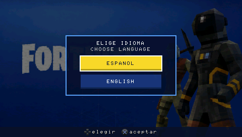


Novedades del parche:

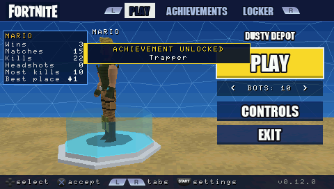
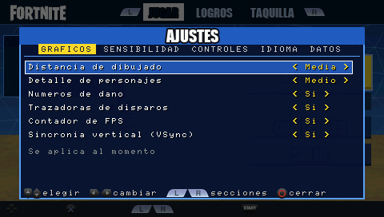
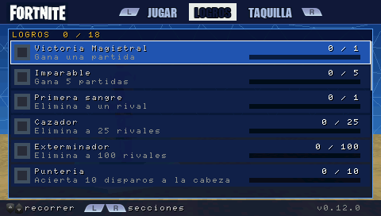
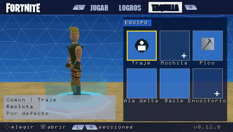
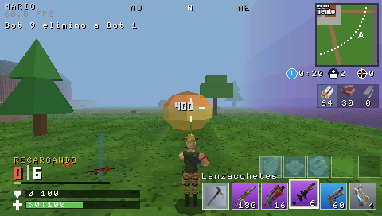
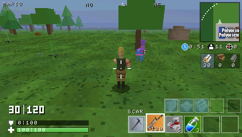
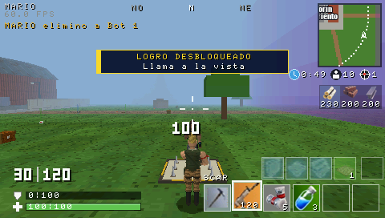

*Capturas de `make app-sim`: la aplicación real, dibujada por el rasterizador por software
de host. No son capturas de una PSP.*

## Qué incluye

**v0.16.0** (todo en [docs/ACTUALIZACION_0_16.md](docs/ACTUALIZACION_0_16.md)):
- **Dúo y escuadrón** en el Battle Royale ([docs/EQUIPOS.md](docs/EQUIPOS.md)): 15 parejas o 10
  equipos de 4, derribados, reanimar con CUADRADO mantenido y barras de los compañeros.
- **Aliados inteligentes** ([docs/ZOMBIS.md](docs/ZOMBIS.md)): 125 de vida y escudo, botín,
  crafteo, huida con cobertura y prioridad absoluta a seguirte, también por las rampas.
- **Camas asignadas** con L: de noche duermen pase lo que pase, sin recibir daño, y de día
  levantan un refugio junto a la cama.
- **Sonido:** el disparo del jugador tiene prioridad sobre los efectos (la escopeta de
  corredera no se oía al acertar).
- **Mapa:** ya no quedan restos de las ruinas en el Battle Royale.

**v0.15.0** (todo en [docs/ACTUALIZACION_0_15.md](docs/ACTUALIZACION_0_15.md) y
[docs/ZOMBIS.md](docs/ZOMBIS.md)), solo en la Supervivencia zombi:
- **Lugares de interés:** 10 ruinas nuevas; cuanto más grandes, más botín y comida y más
  zombis las guardan (algunos, tumbados como cadáveres hasta que te acercas).
- **Hambre y sueño:** comida en neveras, despensas y cofres; se duerme en el **saco de
  dormir** (con el que se empieza) o en una **cama** fabricada; con sueño te equivocas y a
  cero pierdes vida; no se puede dormir con monstruos cerca.
- **Partida guardada:** desde la pausa y sola al amanecer; en el lobby, "Continuar: día N".
- **Aliados:** CUADRADO junto a uno gestiona su inventario; levantan el muro de la base
  aunque no tengas planos; duermen en sus camas fuera de guardia; si caen, se levantan como
  zombis armados.
- **Mochilas** (+3 ranuras) de los brutos y los aliados caídos; **cajas de munición** con
  todos los tipos; **sin límite de piezas**; **días de 300 s** y noches de 180 s.
- **Objetivos** variados con recompensa y pavos.
- **Más miedo:** ojos rojos en la oscuridad, latido, gritos lejanos, susurros, alucinaciones
  y sobresaltos.

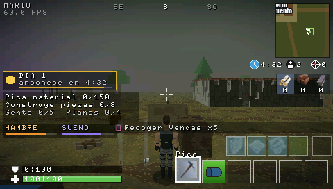
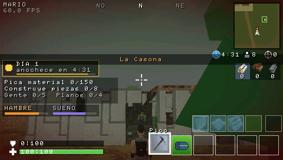
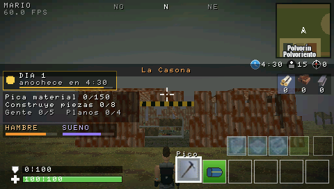
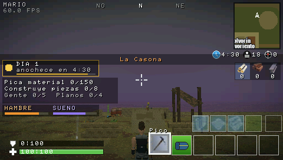
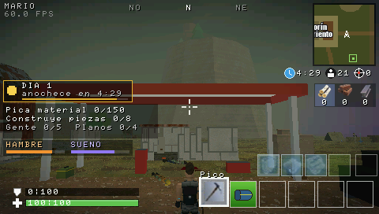
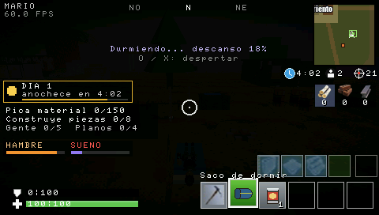
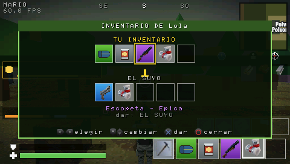
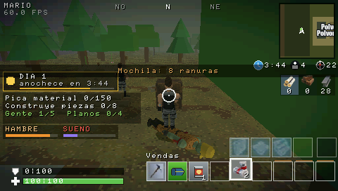
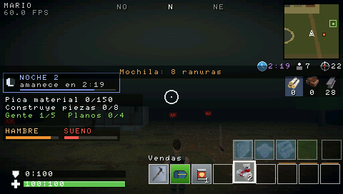
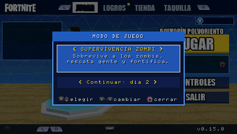

**v0.14.0** (todo en [docs/ACTUALIZACION_0_14.md](docs/ACTUALIZACION_0_14.md)):
- **30 bots por defecto.** Con menos, la partida es **de práctica**: ni pavos ni logros.
- **Bots tácticos:** acampan los airdrops, se encierran en una caja de paredes cuando les
  disparan (y salen al rato), ponen rampas para ganar altura contra quien está más alto y,
  al final de la partida, rotan antes, se colocan a cubierto en la zona y huyen antes.
- **Gráficos:** texturas del mapa a 64×64 con más detalle, cielo con degradado, nubes y sol,
  personajes más redondos con mochila y más detalles, y animaciones nuevas (giro del tronco,
  balanceo, inclinarse en las curvas, caídas distintas, vadear).
- **Agua:** el lago se cruza andando, a la mitad de velocidad y chapoteando.
- **Supervivencia zombi** ([docs/ZOMBIS.md](docs/ZOMBIS.md)): el Polvorín en ruinas y más
  tenebroso, despiertas de un coma en una base abandonada, día y noche con hordas, tres tipos
  de zombi, supervivientes a los que rescatar con un arma y una cura, centros de crafteo
  para fabricar las armas que no hay en el botín (solo escopetas, pistolas y curas) y planos
  para fortificar la base. Pavos por noche sobrevivida y 7 logros nuevos.

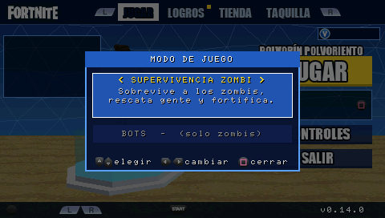
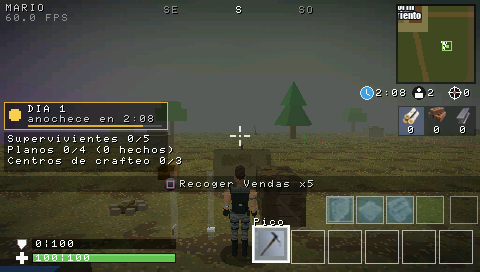
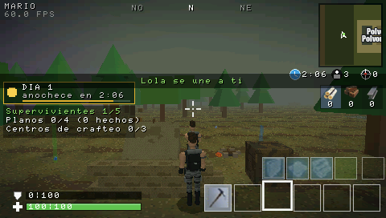
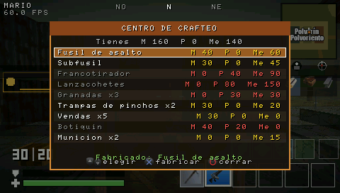
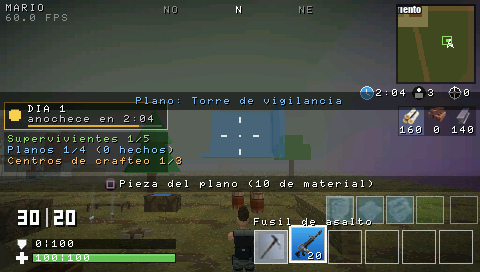
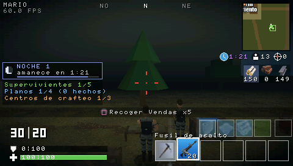
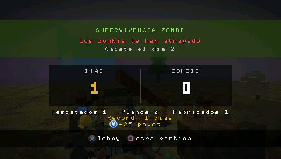
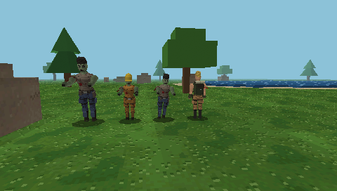
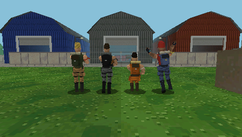
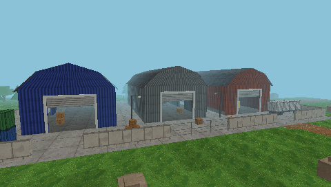

**v0.13.0** (todo en [docs/ACTUALIZACION_0_13.md](docs/ACTUALIZACION_0_13.md)):
- **Combate:** las balas rompen los objetos del mapa (naves, contenedores, cajas, árboles…).
  Número de daño **azul** si el rival tenía escudo. Mira en cruz simétrica, la de la escopeta
  táctica igual que la de corredera y la del lanzagranadas con las marcas de caída.
- **Inventario (L + R a la vez):** mover objetos entre ranuras, soltarlos y llevarlos a la mano.
- **Pavos y tienda:** 50 por victoria y 50 por logro (los de antes se recogen en LOGROS);
  sección TIENDA con los trajes de los bots (poco comunes, 800 pavos). Ver
  [docs/TIENDA.md](docs/TIENDA.md).
- **Bots:** aterrizan sin materiales y pican cuando les faltan; abren cofres y cambian de arma
  hasta tener un inventario completo; con poca vida huyen, se cubren y se curan (o buscan curas).
- **Sonidos:** pistola, revólver, escopeta de corredera, lanzacohetes, botiquín y vendas de
  `Sonidos Limpios`; una recarga distinta por familia de arma.
- **Lobby:** TRIÁNGULO juega, CUADRADO elige el modo (Battle Royale / **Monodisparo**: solo
  francotiradores, armas con mira y granadas) y los bots.
- **Menú de administrador** en AJUSTES > ADMIN (con contraseña): mod menu con 23 trucos y
  acciones, también desde la pausa.

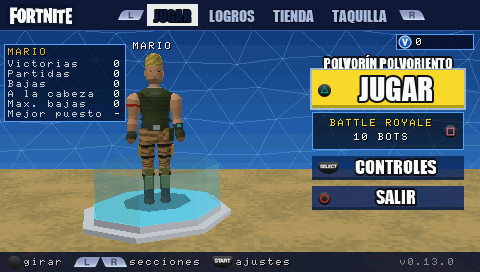
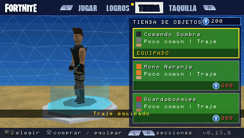
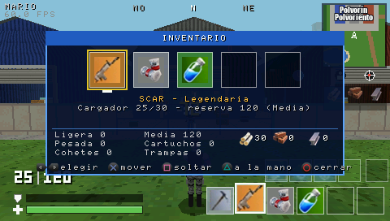
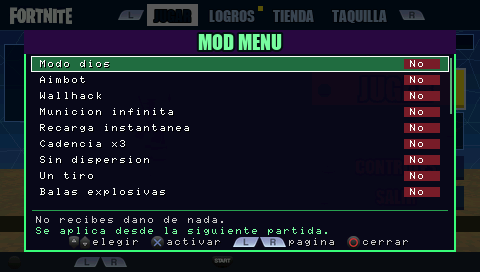

**Fase 8 — parche (v0.12.1)** (todo en [docs/PARCHE.md](docs/PARCHE.md)):
- **Inventario:** cambiar un objeto del suelo por la ranura que se elija (también con un
  curativo en la mano); las armas soltadas conservan su cargador. Curarse deja quieto.
- **Combate:** la mirilla apunta donde apuntaba la mira; agacharse mejora la precisión;
  retroceso por disparo con la mira que se abre.
- **Armas:** 9 nuevas de `Recursos/Weapons` (ráfagas, fusil con mira, subfusil, escopeta
  táctica, pistola, revólver, francotirador semiautomático, lanzacohetes, lanzagranadas) y la
  granada; fusil gris/verde/azul con su propio modelo; modelos 3D para todas.
- **Botín:** los bots sueltan materiales; llama de suministros (5 % por partida).
- **Trampas** de pinchos en suelos, paredes y techos ([docs/TRAMPAS.md](docs/TRAMPAS.md)).
- **Animaciones:** el arma con las dos manos al correr (cinemática inversa) y transiciones.
- **Primer arranque:** pantalla para elegir idioma (español / inglés) antes del inicio de sesión.
- **Lobby:** secciones con L/R: JUGAR, LOGROS ([docs/LOGROS.md](docs/LOGROS.md)) y TAQUILLA
  ([docs/TAQUILLA.md](docs/TAQUILLA.md)); START abre los AJUSTES ([docs/AJUSTES.md](docs/AJUSTES.md)):
  gráficos, sensibilidad, controles reasignables, idioma (español / inglés) y borrar datos.
- **Sonido:** la caja de munición tiene su sonido (ya no el del cofre); sonidos nuevos para
  explosiones, cohetes, pistola, trampa y llama. Botones de la PSP sin contorno azul.

**Fases 1–5:**
- **Base:** arranque y cierre seguros, GU con doble buffer y escenario 3D retro con
  niebla.
- **Jugador:** en tercera persona, con física en paso fijo de 1/60 s.
- **Mapa:** basado en las referencias, con colisiones AABB.
- **Bots:** IA de estados y navegación A*.
- **Combate:** SCAR legendaria con disparo desde la cámara y números de daño.
- **Construcción:** paredes de madera.

**Fase 6:**
- **Pantallas:**
  - **Inicio de sesión** al estilo de Fortnite (sobre `Recursos/loginscreen.png`).
  - **Lobby** como `Referencias/Lobby.png`: JUGAR, CONTROLES y SALIR; personaje que gira
    sobre su plataforma; número de bots.
  - **Carga**, **pausa** y **resultados** de victoria ("#1 Victory Royale!") y de
    derrota ("ELIMINADO"), con puesto, bajas, tiempo, quién te eliminó y la opción de
    seguir mirando.
- **HUD** según `Referencias/Referencia gameplay.png` y `Referencias/HUD/`:
  - minimapa con la zona y brújula;
  - vivos, bajas y tiempo de zona;
  - materiales y ranuras de construcción y de armas;
  - munición "30 | 120", escudo y vida;
  - rótulo de modo construcción.
- **Sonido:**
  - **Efectos:** disparos (con distancia y panorama), impactos, heridas, eliminaciones,
    paredes, recarga, menús, victoria y derrota.
  - **Música:** la del menú en los menús.
  - **Formatos:** WAV PCM e IMA ADPCM, con mezclador propio de 8 voces.
- **Aspecto retro:**
  - framebuffer de 16 bits con tramado;
  - 16 texturas originales de 32×32 con paleta reducida (`Recursos/Texturas/`);
  - niebla de distancia;
  - geometría low-poly coherente.
- **Animaciones:** respiración en reposo, retroceso al disparar, gesto al recibir un
  impacto y caída al ser eliminado.
- **Memoria y estabilidad:**
  - imágenes a 16 bits y atlas recortado: de ~2,6 MB a ~0,8 MB de RAM en interfaz;
  - registro de tiempos y heap de carga;
  - prueba de 10 partidas seguidas sin que crezca la memoria.

Detalle en [docs/PRESENTACION.md](docs/PRESENTACION.md).

**v0.11.0:**
- **Perfil:** la primera vez se pide el nombre con un teclado en pantalla. El perfil se guarda
  en `perfil.txt` junto al EBOOT: nombre, partidas, victorias, bajas, impactos a la cabeza,
  máximo de bajas, mejor puesto y tiempo jugado. Al volver a entrar se carga y se ve en el
  lobby.
- **Mapa:** SELECT abre el mapa a pantalla completa, con la tormenta actual y la siguiente,
  el depósito, los airdrops y el jugador. L + SELECT recorre las páginas del HUD.
- **Disparos a la cabeza:** el doble de daño, con el número en amarillo. Los bots apenas los
  consiguen: de los suyos solo cuenta uno de cada cuatro.
- **Agacharse (cruceta abajo):**
  - **Movimiento:** se va al 55 % de velocidad.
  - **Al recibir disparos:** la caja de impacto es más baja y los bots tienen 1,5° más de
    dispersión. En la simulación recibe la mitad de impactos.
- **Bailar (cruceta arriba):** con la música de `Fortnite bailemp3`, hasta moverse o actuar.
- **Francotirador:** con L, la ayuda de puntería sube a 4° (1° con el resto de armas). Solo
  corrige si la mira no da ya en el rival, así que se puede apuntar a la cabeza.

**v0.10.0** (detalle en [docs/DESTRUCCION.md](docs/DESTRUCCION.md)):
- **Mapa destruible:** todo el mapa salvo el suelo y la meseta se pica. Paredes de las naves
  en paneles de 4 m, tejados, muros, vallas, farolas, contenedores, cajas, árboles y rocas
  dan material, pierden vida y desaparecen.
- **Tejados:** las naves tienen colisión en el tejado; ya no se atraviesa al caer del
  autobús.
- **Cofres:** desaparecen al abrirse.
- **Bots:** llevan varias armas y consumibles, sacan la mejor para la distancia del rival y
  se curan.
- **Construcción:** CUADRADO cambia el material (madera 150, piedra 300, metal 500 de vida);
  si no queda del elegido, se usa otro.
- **Minimapa:** pone "Polvorín Polvoriento" sobre las naves.

**v0.9.1:**
- **Sonidos de más de 3 s:** la victoria, el salto del autobús o la poción de escudo se
  repetían sin parar. La posición de cada voz del mezclador (16.16 en 32 bits) se desbordaba
  a las 65536 muestras y volvía a 0. Ahora es 20.12 (hasta ~47 s) y hay una prueba en
  `app-sim`.
- **Armas en la mano:** cada tipo tiene su modelo 3D (SCAR, escopeta de corredera, subfusil
  con silenciador y francotirador con mira); los bots llevan el arma que han cogido.

**Fase 7, tormenta, construcción completa y mirilla (v0.9.0):**
- **Tormenta que se cierra:** cada 40 s empieza un cierre de 20 s hacia un círculo menor
  (primer cierre a los 60 s; 8 cierres, de 125 m a 0).
  - **Daño:** de 1 a 15 de vida por segundo según la fase; el borde del mapa sigue quitando 30.
  - **Aviso:** sonido de la tormenta y "La tormenta se está cerrando".
  - **HUD:** en el minimapa, el círculo actual en morado y el siguiente en blanco; bajo él, el
    tiempo hasta el siguiente cierre.
  - **Bots:** entran en la zona cuando les toca.
  - **Código:** `game/storm_zone.*`.
- **Suelos y rampas:** R los coloca (10 de madera, como las paredes).
  - **Colocación:** van en la celda de delante; desde lo alto de una rampa, un piso más arriba.
  - **Rampa:** 8 escalones de colisión de 0,375 m (se sube andando) dibujados como una losa
    inclinada.
- **Miras:** cuadrada con la escopeta, redonda con los curativos y en cruz con el resto.
- **Mirilla del francotirador:** con L se mira por `Recursos/mirilla.png`.
  - **Vista:** primera persona con zoom ×4 (campo de visión de 15°).
  - **Puntería:** el stick va más lento y no se fija el objetivo.

**Fase 7, botín y autobús (v0.8.0)** (detalle en [docs/BOTIN.md](docs/BOTIN.md)):
- **Armas:** fusil de asalto/SCAR, escopeta de corredera, subfusil con silenciador y
  francotirador de cerrojo, cada uno con su rareza, daño, cadencia, dispersión y munición
  común por tipo.
- **Botín:** cofres, botín de suelo, cajas de munición y airdrops con armas legendarias.
  CUADRADO abre y recoge (y si no hay nada, recarga).
- **Autobús y caída:** autobús de batalla quieto en el cielo, salto con X, caída libre y
  ala delta con X.
- **Bots:** caen igual, aterrizan sin arma y van a por botín, pelean según su arma, cazan
  al rival más cercano, oyen los disparos y se cubren con paredes.
- **Puntería:** más difícil (ayuda de 1°, dispersión, L ya no clava la cámara).

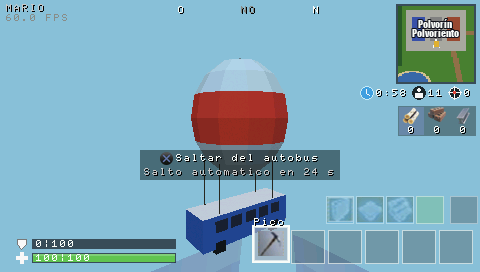
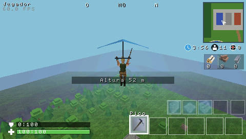
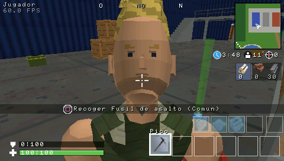

**Fase 7, tormenta en el límite del mapa (v0.7.3)** (detalle en
[docs/MUNDO.md](docs/MUNDO.md#límite-del-mapa-la-tormenta-fase-7)):
- **Sin pared invisible:** el borde es una tormenta morada.
- **Niebla:** se espesa al acercarse y dentro deja ver unos 13 m, así que nunca se ve
  dónde acaba el mundo.
- **Daño:** 30 por segundo directo a la vida.
- **Avisos:** muro de tormenta, avisos en el HUD, tinte morado, el sonido `avisotormenta`
  y la tormenta marcada en el minimapa.

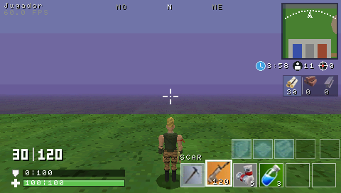
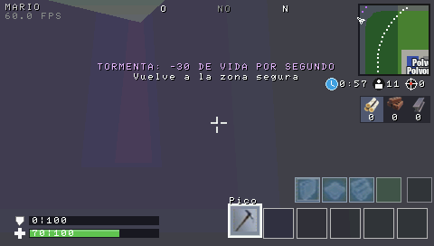

**Fase 7, recursos nuevos (v0.7.2):**
- **Ayudas de controles:** todas usan los iconos de los botones de `Recursos/Texturas PSP`.
- **Inicio de sesión:** solo "Pulsa (X) para iniciar" y una barra de carga.
- **Sonidos de `Sonidos Limpios`:** disparo de la SCAR, Victory Royale, caída del
  jugador, beber minipoción y poción de escudo, y pasos. Los que aún no tienen mecánica
  no se usan.
- **Ranuras:** vendas, botiquín y poción de escudo con sus imágenes de `Recursos/HUD`.

Detalle en [docs/PRESENTACION.md](docs/PRESENTACION.md#ayudas-de-controles-con-los-botones-de-la-psp).

**Fase 7, mejora del personaje** (detalle en [docs/JUGADOR.md](docs/JUGADOR.md#modelo-del-personaje-fase-7)):
deja de ser un conjunto de cajas.
- **Forma:** volúmenes redondeados con proporciones de Fortnite.
- **Articulaciones:** codos y rodillas.
- **Sombreado:** suave por vértice.
- **Textura:** sin filtrar (cara, camuflaje, pelo).
- **Rifle:** se sujeta con las dos manos al apuntar.
- **Nivel de detalle:** uno bajo para los bots lejanos.


**Fase 7, paso 1** (detalle en [docs/INVENTARIO.md](docs/INVENTARIO.md)):
- **Inventario:** 5 ranuras con armas y consumibles; la cruceta cambia de ranura.
- **Consumibles:** vendas, botiquín, minipoción y poción de escudo, con su tiempo de uso.
- **Escudo:** absorbe el daño antes que la vida.
- **Pico (TRIÁNGULO):** pica árboles, cajas, rocas y contenedores, que dan madera, piedra
  y metal. También golpea a los bots y a las paredes.
- **Coste de las paredes:** 10 de madera cada una.
- **Controles nuevos:** la cámara sigue al stick y L es el modo apuntado.
- **Sin cambios:** los bots, las colisiones y el disparo.

## Requisitos

- Toolchain [pspdev](https://github.com/pspdev/pspdev) (probado con el instalado en
  `~/pspdev`: GCC 15.2.0, pspsdk `6f15c15` del 2026-09-28).
- GNU Make (vale el 3.81 de macOS).
- **Opcional:**
  - Python 3 + Pillow + numpy y `afconvert` de macOS: solo para `make assets`. Los
    recursos ya convertidos están en `assets/`.
  - Compilador C++ de Xcode: solo para las herramientas de host (`app-sim`, `preview`,
    `physics-test`, `match-sim`).

El `Makefile` localiza el SDK por este orden: variable `PSPDEV`, `psp-config` en el
`PATH`, y por último `~/pspdev`. No hace falta tocar el `PATH`.

## Compilar

```sh
cd "/Users/mario/Documents/Fortnite PSP"
make && make release
```

- **`make`:** genera `EBOOT.PBP` en la raíz del proyecto (título en el XMB:
  **FortnitePSP**, `DISC_ID` `FNPS00001`, con `ICON0.PNG` y `PIC1.PNG` de la pantalla de
  carga).
- **`make release`:** lo copia a `build/PSP/GAME/FortnitePSP/EBOOT.PBP`.

| Comando             | Resultado                                                          |
|---------------------|--------------------------------------------------------------------|
| `make`              | Compila y empaqueta `EBOOT.PBP`                                    |
| `make release`      | Copia el EBOOT a `build/PSP/GAME/FortnitePSP/EBOOT.PBP`            |
| `make assets`       | Regenera `assets/` a partir de `Recursos/` (Python + Pillow)       |
| `make app-sim`      | La aplicación completa simulada en el Mac: menús, partidas, audio y capturas (`build/app_sim/`) |
| `make preview`      | Renderiza el mapa y los personajes por software en el Mac (`build/preview/`) |
| `make physics-test` | Pruebas de movimiento, salto, cámara y colisiones en el Mac        |
| `make match-sim`    | Partidas simuladas en el Mac: colisiones, disparos, IA, construcción y sucesos |
| `make clean`        | Borra objetos, `.elf`, `.prx`, `PARAM.SFO` y `EBOOT.PBP`           |
| `make web`          | Versión para PC en el navegador (teclado y ratón): `web/dist/index.html`. Necesita Emscripten; ver [`web/README.md`](web/README.md) |
| `make distclean`    | `clean` + borra `build/`                                           |

### Instalar

- **PSP real (CFW):** copiar la carpeta `build/PSP/GAME/FortnitePSP/` a
  `ms0:/PSP/GAME/FortnitePSP/` de la Memory Stick.
- **PPSSPP:** abrir directamente `EBOOT.PBP`.

### Versiones funcionales guardadas

- **Git:** cada fase se cierra con un commit y una etiqueta (`v0.5.0`, `v0.6.0`), y dentro
  de la fase hay un commit por cada hito que compila y pasa las pruebas.
- **Copia del EBOOT:** el de cada versión se guarda en `releases/vX.Y.Z/EBOOT.PBP`. Esta
  carpeta no se sube a git.
- **Releases de GitHub:** cada versión publica `FortnitePSP-vX.Y.Z.zip` con el juego ya
  compilado (descargar, copiar a la Memory Stick y jugar).

### Registro de diagnóstico

En cada arranque se escribe `fortnitepsp_log.txt` en la misma carpeta que el EBOOT:
- **Carga:** cada paso, con su tiempo en ms y el heap en uso, y el tamaño de las imágenes
  y del audio.
- **Partida:** al empezar, el tiempo de preparación, el heap y su diferencia con el primer
  lobby. Al acabar, el ganador, el frame medio y el máximo, el coste de la IA, los
  disparos, las paredes, el heap y los sonidos perdidos.
- **Salida:** el motivo de salida.

## Controles

**Menús:**

| Pantalla          | Botón                  | Acción                                              |
|-------------------|------------------------|-----------------------------------------------------|
| Inicio de sesión  | **X**                  | Iniciar sesión (conexión simulada)                  |
| Lobby (JUGAR)     | **TRIÁNGULO**          | Jugar                                               |
| Lobby (JUGAR)     | **CUADRADO**           | Modo de juego (Battle Royale / Monodisparo / Supervivencia zombi), equipos (Solo / Dúo / Escuadrón, solo Battle Royale) y bots (panel: ↑↓ fila, ←→ valor; CUADRADO, X u O cierran). En solitario con menos de 30 bots, práctica |
| Lobby (JUGAR)     | **SELECT**             | Controles                                           |
| Lobby (JUGAR)     | **CÍRCULO**            | Salir (pide confirmación: X sale, O cancela)        |
| Lobby             | **Stick**              | Girar el personaje                                  |
| Lobby             | **L / R**              | Secciones: JUGAR / LOGROS / TIENDA / TAQUILLA       |
| Logros            | **↑ ↓ + X**            | Recorrer y recoger la recompensa (50 pavos)         |
| Tienda            | **↑ ↓ + X**            | Elegir y comprar (con confirmación) o equipar lo comprado |
| Lobby             | **START**              | Ajustes (modal: L/R secciones del menú, ↑↓ opción, ←→ valor, X activar, O o START cerrar) |
| Taquilla          | **Cruceta + X**        | Elegir categoría y equipar (O vuelve)               |
| Controles         | **O**                  | Volver al lobby                                     |
| Pausa             | **↑ ↓ + X**            | CONTINUAR / VOLVER AL LOBBY (START u O: continuar)  |
| Resultados        | **X**                  | Volver al lobby                                     |
| Resultados        | **CUADRADO**           | Otra partida                                        |
| Resultados (derrota) | **CÍRCULO**         | Seguir mirando hasta el final                       |
| Cualquiera        | **L + R + START 1 s**  | Salir del juego (vuelve al XMB)                     |

**Partida:**

| Modo          | Botón                                  | Acción                                       |
|---------------|----------------------------------------|----------------------------------------------|
| Siempre       | **Stick analógico**                    | Andar / correr; la cámara se coloca sola detrás (no al ir hacia atrás) |
| Siempre       | **X**                                  | Saltar (mantener = salto completo)           |
| Combate       | **Cruceta ↓ / ↑**                      | Agacharse / bailar                           |
| Siempre       | **SELECT**                             | Mapa a pantalla completa (L + SELECT: páginas del HUD) |
| Siempre       | **L (mantener)**                       | Apuntar: con un enemigo a la vista gira la cámara hacia él (el stick mueve de lado); sin él, el stick mueve la mira |
| Combate       | **Cruceta ← →**                        | Cambiar de ranura del inventario             |
| Combate       | **L + R a la vez**                     | Inventario: ←→ elegir, X mover, □ soltar, △ a la mano, O cerrar |
| Combate       | **TRIÁNGULO**                          | Sacar / guardar el pico                      |
| Combate       | **R**                                  | Disparar (arma), golpear (pico, mantener) o usar (consumible) |
| Combate       | **CUADRADO**                           | Abrir / recoger lo que haya al alcance; si no, recargar |
| Autobús / caída | **X**                                | Saltar del autobús / abrir el ala delta (stick: dirigir la caída) |
| Siempre       | **CÍRCULO**                            | **Modo construcción on/off**                 |
| Construcción  | **Cruceta ← →**                        | Elegir pieza: pared, suelo, rampa o trampa   |
| Construcción  | **R (pulsar)**                         | Colocar la pieza (10 de material) o la trampa donde apunta la mira |
| Construcción  | **CUADRADO**                           | Cambiar de material (madera / piedra / metal) |
| Siempre       | **START**                              | Pausa                                        |
| Siempre       | **SELECT**                             | HUD: partida → depuración → controles → oculto |
| Depuración    | **TRIÁNGULO**                          | Cámara libre ↔ tercera persona (dentro: □ niebla, START VSync) |

Los botones de las acciones de la partida (saltar, construir, recargar/recoger, pico,
disparar, apuntar, agacharse, bailar) se pueden reasignar en AJUSTES > CONTROLES; la tabla
muestra los de por defecto. Con el inventario lleno, CUADRADO abre un selector: cruceta
←/→ elige la ranura, CUADRADO cambia, CÍRCULO cancela.

**Supervivencia zombi** (además de lo anterior; no hay autobús):

| Dónde | Botón | Acción |
|-------|-------|--------|
| Junto a un superviviente | **CUADRADO** | Darle lo que llevas en la mano (necesita un arma y una curación) |
| Junto a un centro de crafteo | **CUADRADO** | Menú de crafteo: ↑↓ elegir, X fabricar, O cerrar |
| Junto a una pieza fantasma de un plano | **CUADRADO** | Construirla (10 de material, reforzada) |
| Un plano en el suelo | **CUADRADO** | Recogerlo (aparecen sus piezas en la base) |
| Comida / cama / saco de dormir en la mano (v0.15) | **R** | Comer / colocar la cama / dormir aquí |
| Junto a una cama, nevera o despensa (v0.15) | **CUADRADO** | Dormir / registrarla |
| Durmiendo (v0.15) | **CÍRCULO** o **X** | Despertar |
| Junto a un aliado (v0.15) | **CUADRADO** | Su inventario (X dar / quitar) |
| Junto a una cama, con aliados (v0.16) | **L** | Asignarla a un aliado: ↑↓ elegir, X asignar, O cerrar |
| Pausa del modo zombi (v0.15) | **X** | Guardar partida / guardar y salir |

**Dúo y escuadrón** (v0.16):

| Dónde | Botón | Acción |
|-------|-------|--------|
| Junto a un compañero derribado | **CUADRADO mantenido** | Reanimarle (10 s) |
| Derribado | **Stick** | Arrastrarse (no se puede hacer nada más) |

Detalle en [docs/INVENTARIO.md](docs/INVENTARIO.md),
[docs/COMBATE_CONSTRUCCION.md](docs/COMBATE_CONSTRUCCION.md) y
[docs/JUGADOR.md](docs/JUGADOR.md).

## Limitaciones conocidas

- **v0.16.0 sin probar en ejecución real:** los FPS con 40 personajes en escuadrón (hasta ahora
  el máximo eran 31) y si los tiempos de derribo y reanimación se sienten bien.
- **v0.15.0 sin probar en ejecución real:** los FPS con los lugares nuevos y los guardianes,
  si la noche (más oscura) se ve bien en la PSP-2000, que se lean los textos nuevos del HUD
  y que el guardado (`partida_zombis.txt`) funcione en la Memory Stick. El límite de piezas
  del modo zombi es el técnico (128 a la vez).

- **v0.14.0 sin probar en ejecución real:** el rendimiento con 30 bots por defecto y los
  personajes más detallados, el modo zombi (22 zombis y la noche) y si la noche se ve
  demasiado oscura en la PSP-2000.

- **v0.7.2 sin probar en ejecución real:** falta oír en la PSP los sonidos nuevos (sobre
  todo los pasos y beber) y comprobar que los iconos de botón se leen en la pantalla.
- **v0.7.1 sin probar en ejecución real:** ni PPSSPP ni la PSP. Falta comprobar los FPS
  con el personaje nuevo y 30 bots: cada modelo cercano tiene 1292 triángulos y cada
  lejano 564, frente a 348 antes (ver la página de depuración).

  Según el usuario, en la PSP funcionan la v0.6.0 con 30 bots y la v0.7.0 (inventario,
  pico y cámara).
- **Inicio de sesión simulado:** no hay red, cuentas ni partidas online. El nombre es
  siempre "Jugador".
- **v0.8.0 sin probar en ejecución real:** el rendimiento con el botín a la vista y los 30
  bots cayendo a la vez, y el tacto de la caída y de la puntería nueva.
- **Partidas cortas:** los bots se buscan y las partidas simuladas duran 1-1,5 min. Se
  ajusta en `MatchConfig` (ver docs/BOTIN.md).
- **Objetos agotados:** al picarlos no desaparecen. Las copas de los árboles no tienen
  colisión y la cámara puede quedar dentro de ellas.
- **Construcción:** solo funciona la pared; suelo y rampa se eligen con la cruceta, pero
  aún no se colocan. Piedra y metal se acumulan, pero aún no se usan.
- **Los bots** no usan escudo ni consumibles.
- **Zona que se cierra simplificada:** un círculo que se cierra en 4 min y guía a los bots
  hacia el depósito. Fuera de ella no se pierde vida; solo hace daño la tormenta fija del
  límite del mapa. El reloj del HUD muestra lo que falta para que termine de cerrarse.
- **Bots:** 30 por defecto (desde la v0.14), configurables de 5 a 30; con menos de 30 la
  partida es de práctica.
- **Texto:** se usa la fuente 8×8 de depuración, sin tildes ni eñes (por eso se lee
  "Contrasena" o "elimino"). Los rótulos grandes (JUGAR, ELIMINADO…) sí las llevan,
  porque son imágenes.
- **Música:** solo en los menús; en la partida suenan solo los efectos.
  - El remuestreo es simple (vecino más cercano).
  - Los sonidos se oyen a través de las paredes, sin oclusión.
- **Espectador:** sigue a quien te eliminó o, si ya no está, al primer superviviente. No
  se puede cambiar de jugador.
- **Sin guardado:** no se guardan ajustes ni estadísticas entre sesiones.
- **Pantalla de carga:** dura como mínimo 2 s, aunque la partida esté lista antes, para
  que se pueda leer.
- **Salir:** con L+R+START. HOME lo gestiona el sistema.

## Estructura

```
Makefile                     Build basado en build.mak de PSPSDK
docs/ACTUALIZACION_0_16.md   v0.16: duo y escuadron, aliados inteligentes, camas asignadas
docs/EQUIPOS.md              Duo y escuadron: derribados, reanimar e IA de equipo (v0.16)
docs/ACTUALIZACION_0_15.md   v0.15: Supervivencia zombi a fondo
docs/ACTUALIZACION_0_14.md   v0.14: 30 bots, bots tacticos, graficos, agua y modo zombi
docs/ZOMBIS.md               Supervivencia zombi (v0.14)
docs/ACTUALIZACION_0_13.md   v0.13: mapa que se rompe, inventario, pavos, IA, admin, Monodisparo
docs/TIENDA.md               Pavos, recompensas y tienda de objetos (v0.13)
docs/PRESENTACION.md         Pantallas, HUD, estilo, animaciones, sonido, memoria (fase 6)
docs/INVENTARIO.md           Inventario, escudo, curas, pico y materiales (fase 7)
docs/BOTIN.md                Armas, botin, autobus, ala delta, airdrops y bots de la fase 7
docs/DESTRUCCION.md          Mapa destruible, tejados, materiales de construccion, inventario de los bots
docs/MUNDO.md                Escala, ejes, plano del mapa, colisiones y texturas
docs/JUGADOR.md              Controles, movimiento, salto, paso fijo y cámara
docs/BOTS.md                 IA, disparos, partida, rendimiento y verificación
docs/COMBATE_CONSTRUCCION.md Arma, apuntado, paredes, controles y verificación
docs/capturas/               Capturas de app-sim y del previsualizador de host
src/
  main.cpp                   Módulo PSP, arranque, bucle principal y cierre
  app/app.*                  Ciclo de vida, partida, sucesos -> sonido, dibujo 3D
  app/app_menus.cpp          Inicio de sesión, lobby, controles, carga, pausa, resultados
  app/app_hud.cpp            HUD, minimapa, páginas de depuración y de controles
  app/lobby_scene.*          Escena 3D del lobby
  app/ui.*                   Atlas de interfaz (iconos, rótulos, banners)
  app/build_visuals.*        Paredes, pared fantasma y números grandes del HUD
  audio/                     Mezclador, WAV e IMA ADPCM, canal de pspaudiolib
  camera/                    Tercera persona (colisión, fijar objetivo) y cámara libre
  core/                      Configuración, temporizador, generador aleatorio
  game/                      Personajes, jugador, bots, partida y sucesos, arma, inventario, paredes, A*
  gfx/                       GU: estado 2D/3D, mallas, texturas, sprites, líneas, texto
  world/                     Mapa (visual + colisión), objetos recolectables, texturas, minimapa
  assets/                    Recursos incrustados (.incbin) y rectángulos del atlas
  input/ math/ platform/ third_party/
assets/                      Recursos convertidos (los genera make assets)
tools/app_sim/               La aplicación completa simulada (Mac)
tools/host/                  Rasterizador por software y recursos para las herramientas
tools/scene_preview/         Previsualizador por software (Mac)
tools/physics_test/          Pruebas de movimiento y colisión (Mac)
tools/match_sim/             Simulador de partidas (Mac)
tools/prepare_assets.py      Conversión Recursos/ -> assets/
tools/generate_*.py          Generadores de texturas, sonidos e iconos originales
Recursos/ Referencias/       Recursos directos / material de referencia
```

### Recursos y referencias

**`Recursos/`**, usados directamente en el juego:
- **Imágenes:**
  - `loginscreen.png`: pantalla de inicio de sesión.
  - `Loadscreen - match.png`: pantalla de carga, `PIC1.PNG` e `ICON0.PNG`.
  - `fortnite_PNG25.png`: logotipo del lobby.
  - `HUD/`: iconos de construcción (Pared, Suelo, Rampa, Pico), rótulo de victoria,
    materiales (`Wood_icon`, `stone_orig`, `Metal_icon`), ranuras de los consumibles
    (`Vendas.webp`, `botiquin.jpg`, `escudo grande.jpg`, `minipocion.png`) e iconos
    originales (vivos, bajas, zona, escudo y vida, de `tools/generate_hud.py`).
  - `Texturas PSP/`: botones de la PSP para las ayudas de controles.
  - `Weapons/AssaultRiffleLegendary.png`: ranura de la SCAR en el HUD.
- **`Texturas/`:** 16 texturas originales de 32×32 (`tools/generate_textures.py`).
- **`Sonidos/`:**
  - efectos originales (`tools/generate_sounds.py`);
  - `Sonidos Limpios/`: sonidos del usuario (ver docs/PRESENTACION.md; los que aún no
    tienen mecánica no se empaquetan). `avisotormenta` suena al entrar en la tormenta;
  - `main title song.wav`, la música del menú.

**`Referencias/`**, solo como guía:
- **Mapa:** "Polvorín Polvoriento".
- **Personaje:** el modelo.
- **Armas:** el color del rifle.
- **Gameplay y HUD:** la distribución y el aspecto del HUD.
- **Lobby:** la composición del lobby.

## Estado de las pruebas

- **Compilación:** sin errores ni warnings con `-Wall -Wextra` (PSP y host).
- **v0.16.0: `make app-sim` 0 fallos en 211 comprobaciones, `make match-sim` 0 fallos en
  296, `make physics-test` 0 fallos.** Lo nuevo está en las secciones 12 (app-sim) y 22
  (match-sim); ver [docs/ACTUALIZACION_0_16.md](docs/ACTUALIZACION_0_16.md).
- **v0.15.0: `make app-sim` 0 fallos en 189 comprobaciones, `make match-sim` 0 fallos en
  257, `make physics-test` 0 fallos.** Lo nuevo está en las secciones 6c (app-sim) y 21
  (match-sim); ver [docs/ACTUALIZACION_0_15.md](docs/ACTUALIZACION_0_15.md).
- **v0.14.0: `make app-sim` 0 fallos en 178 comprobaciones, `make match-sim` 0 fallos en
  231, `make physics-test` 0 fallos.** Lo nuevo está en las secciones 11 (app-sim) y 20
  (match-sim); ver [docs/ACTUALIZACION_0_14.md](docs/ACTUALIZACION_0_14.md).
- **v0.13.0: `make app-sim` 0 fallos en 164 comprobaciones, `make match-sim` 0 fallos en
  206, `make physics-test` 0 fallos.** Lo nuevo está en las secciones 10 (app-sim) y 19
  (match-sim); ver [docs/ACTUALIZACION_0_13.md](docs/ACTUALIZACION_0_13.md).
- **`make app-sim`: 0 fallos en 92 comprobaciones.** Es la aplicación real, con mando,
  reloj y audio simulados.
  - **Controles de la fase 7:** cruceta, consumibles, pico frente a un árbol, cámara que
    sigue al andar, L + stick, piezas de construcción y cámara libre.
  - **Audio:** formato de los 26 efectos. La música decodificada frente a la original,
    con SNR de 33 dB y sin chasquidos. El panorama, las 8 voces y la cola llena.
  - **Flujo:** inicio de sesión → lobby → controles → lobby → carga → partida (disparos,
    construcción, recarga, páginas del HUD, pausa) → derrota → seguir mirando → fin →
    otra partida → victoria → lobby.
  - **Estabilidad:** 8 partidas más alternando victoria, derrota, reinicio y abandono
    desde la pausa. Se comprueba:
    - que cada transición funciona;
    - que cada partida empieza limpia (sin paredes ni cajas dinámicas, con la
      navegación intacta);
    - que el heap no crece;
    - que no se pierde ningún sonido.
- **`make match-sim`: 0 fallos en 138 comprobaciones.** Navegación, colisiones, disparos,
  eliminaciones, 8 partidas completas con 10 y 30 bots, arma, disparo desde la cámara,
  construcción, IA frente a paredes, sucesos de sonido, y en la fase 7: inventario,
  escudo, curas, pico, materiales, coste de las paredes, tormenta del límite del mapa, armas,
  botín, autobús, airdrops, bots que se cubren y partidas completas con las reglas nuevas.
- **`make physics-test`: 0 fallos.**
- **`make preview`:** 7 vistas del mapa, 5 de juego con personajes y 1 de construcción,
  con las texturas de `Recursos/Texturas`.
- **Sin probar en ejecución real:** ni PPSSPP ni la PSP (ver *Limitaciones conocidas*).

## Historial de correcciones

- **v0.8.0:**
  - **Interpolación:** dentro del autobús, la cámara se iba al suelo porque se mezclaba con
    la posición anterior. Ahora el autobús coloca al personaje sin interpolar
    (`CharacterBody::place`).
  - **Pruebas:** los bots se cubrían con una pared a mitad de la resolución de un disparo
    y la comprobación independiente veía esa pared. Ahora construyen en su paso
    siguiente.
- **v0.7.3:**
  - **Límite del mapa:** la pared invisible del borde pasa a ser una tormenta.
  - **Pruebas:** `Match::teleport()` (solo pruebas) no conservaba el escudo; ahora sí.
- **v0.7.2:** sin correcciones de errores; recursos del usuario (sonidos, botones,
  ranuras) y login simplificado.
- **v0.7.1:** sin correcciones de errores; personaje nuevo e iconos de `Recursos`.
- **v0.7.0:** ninguna corrección de errores; solo mecánicas nuevas.
- **v0.6.0:**
  - **Música:** el mezclador se saltaba una muestra de música en cada bloque de audio.
    Se detectó al escribir el decodificador, antes de publicar.
  - **Recurso sobrante:** se quitó del ejecutable el logotipo de la antigua portada; el
    lobby usa el del atlas.
- **v0.5.0:**
  - **Esquinas:** dos paredes perpendiculares se rechazaban porque se solapaban en la
    esquina, y no se podía cerrar un recinto. Ahora en la rejilla solo chocan las paredes
    paralelas repetidas.
  - **Fuera de alcance:** se podía colocar una pared al otro lado de la fachada de una
    nave; ahora se comprueba que no haya ningún sólido entre el jugador y la pared.
  - **Paredes indestructibles para la IA:** un jugador encerrado era invulnerable porque
    los bots, sin línea de visión, no disparaban. Ahora rompen la pared.
- **v0.4.0:** `Match::teleport()` (solo pruebas) reiniciaba la vida al mover una
  entidad; ahora la conserva.
- **v0.3.0:** el paso fijo de física hacía 1, 3, 2, 2… pasos a 30 FPS por redondeo de
  `float`, y a 59,94 Hz sumaba de vez en cuando un paso de más. Ahora los frames a menos
  de un 2 % de N pasos exactos cuentan como N pasos.
- **v0.2.0:** la v0.1.0 se cerraba nada más abrirse (comprobado en una PSP 2000 con
  ARK-4). `guGetStaticVramBuffer()` devuelve desplazamientos relativos a la VRAM y el
  primer framebuffer vale 0, pero `if (!fbp0)` lo trataba como error.
