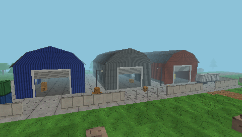
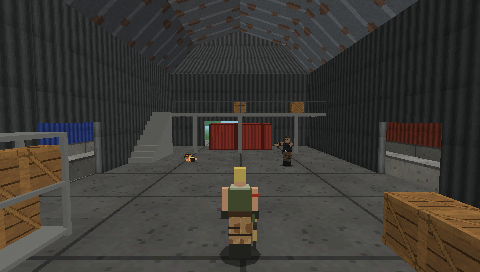
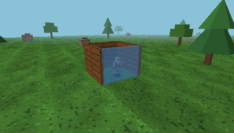

# FortnitePSP

Demake estilo PS1 de Fortnite para PSP, escrito en C++ sobre PSPSDK.

**Estado: fase 5 (combate y construcción).**

- **Fase 1:** arranque y cierre, GU con doble buffer, portada, controles, FPS reales y
  salida por combinación.
- **Fase 2:** renderizado 3D retro: perspectiva, profundidad, texturas de 32×32 sin
  filtrar y niebla.
- **Fase 3:** jugador en tercera persona, salto y gravedad, física en paso fijo de 1/60 s.
- **Fase 4:**
  - **Mapa:** depósito "Polvorín", ceñido a `Referencias/Referencias Primer Mapa`: tres
    naves con interiores, altillos y escaleras, muro, vallas, meseta de roca, bosque y
    lago.
  - **Colisiones:** con cajas AABB, separadas de la geometría visual.
  - **Bots:** 10 por defecto, configurables hasta 30. IA con estados (explorar,
    desplazarse, buscar objetivo, atacar, eliminado), navegación A* y decisiones a
    intervalos.
  - **Disparos:** por raycast; no atraviesan paredes.
  - **Partida:** vida, eliminaciones, contador de vivos y victoria.
- **Fase 5:**
  - **SCAR legendaria:** 36 de daño, 30 balas, 5,5 disparos/s y 2 s de recarga.
  - **Apuntado:** con el centro de la cámara; un raycast desde la cámara elige el primer
    objeto alcanzado.
  - **Interfaz de combate:** números de daño como en Fortnite, retícula y munición.
  - **Construcción (CÍRCULO):** paredes de madera en rejilla de 4 m, validadas antes de
    colocarlas, con límite configurable, retirada y 150 de vida.
  - **Colisión compartida:** física, IA, disparos y dibujo usan la misma caja de colisión.

No hay inventario, construcción libre ni más armas.





## Requisitos

- Toolchain [pspdev](https://github.com/pspdev/pspdev) (probado con el instalado en
  `~/pspdev`: GCC 15.2.0, pspsdk `6f15c15` del 2026-09-28).
- GNU Make (vale el 3.81 de macOS).
- Opcional: Python 3 + Pillow (solo para `make assets`) y el compilador C++ de Xcode
  (solo para las herramientas de host: `preview`, `physics-test`, `match-sim`).

El `Makefile` localiza el SDK por este orden: variable `PSPDEV`, `psp-config` en el
`PATH`, y por último `~/pspdev`. No hace falta tocar el `PATH`.

## Compilar

```sh
cd "/Users/mario/Documents/Fortnite PSP"
make
```

Genera `EBOOT.PBP` en la raíz del proyecto (título en el XMB: **FortnitePSP**,
`DISC_ID` `FNPS00001`).

| Comando             | Resultado                                                          |
|---------------------|--------------------------------------------------------------------|
| `make`              | Compila y empaqueta `EBOOT.PBP`                                    |
| `make release`      | Copia el EBOOT a `build/PSP/GAME/FortnitePSP/EBOOT.PBP`            |
| `make assets`       | Regenera `assets/` a partir de `Recursos/` (Python + Pillow)       |
| `make preview`      | Renderiza el mapa y los personajes por software en el Mac (`build/preview/`) |
| `make physics-test` | Pruebas de movimiento, salto, cámara y colisiones en el Mac        |
| `make match-sim`    | Partidas simuladas en el Mac: colisiones, disparos, IA y rendimiento |
| `make clean`        | Borra objetos, `.elf`, `.prx`, `PARAM.SFO` y `EBOOT.PBP`           |
| `make distclean`    | `clean` + borra `build/`                                           |

### Instalar

- **PSP real (CFW):** copiar la carpeta `build/PSP/GAME/FortnitePSP/` a
  `ms0:/PSP/GAME/FortnitePSP/` de la Memory Stick.
- **PPSSPP:** abrir directamente `EBOOT.PBP`.

### Registro de diagnóstico

En cada arranque se escribe `fortnitepsp_log.txt` en la misma carpeta que el EBOOT:
- **Arranque:** cada paso, con el tiempo y la memoria del escenario, la navegación y los
  modelos.
- **Partida:** una línea al empezar y otra al acabar, con el ganador, el frame medio y el
  máximo, el coste de la IA, los atascos y los disparos.
- **Salida:** el motivo de salida.

Sirve para medir el rendimiento con 10 bots antes de subir a 30, y para saber hasta dónde
llegó si la aplicación se cierra sola.

## Controles

| Pantalla      | Botón                                  | Acción                                       |
|---------------|----------------------------------------|----------------------------------------------|
| Portada       | **← →**                                | Número de bots (5–30, por defecto 10)        |
| Portada       | **X**                                  | Jugar                                        |
| Partida       | **Stick analógico**                    | Andar / correr (relativo a la cámara)        |
| Partida       | **X**                                  | Saltar (mantener = salto completo)           |
| Partida       | **Cruceta ← → / ↑ ↓**                  | Girar la cámara / subir o bajar la mira      |
| Partida       | **CÍRCULO**                            | **Modo construcción on/off**                 |
| Combate       | **R (mantener)**                       | Disparar la SCAR                             |
| Combate       | **CUADRADO**                           | Recargar                                     |
| Combate       | **L (mantener)**                       | Fijar objetivo (o recolocar la cámara)       |
| Construcción  | **R (pulsar)**                         | Colocar una pared delante                    |
| Construcción  | **CUADRADO**                           | Quitar la pared apuntada                     |
| Partida       | **TRIÁNGULO**                          | Cámara libre de depuración ↔ tercera persona |
| Cámara libre  | **Stick / Cruceta / R-L / □ / START**  | Orbitar / mover / zoom / niebla / VSync      |
| Partida       | **SELECT**                             | HUD: partida → depuración → controles → oculto |
| Fin de partida | **X**                                 | Jugar otra vez                               |
| Cualquiera    | **L + R + START mantenidos 1 segundo** | Salir del juego (vuelve al XMB)              |

Detalle de combate y construcción en
[docs/COMBATE_CONSTRUCCION.md](docs/COMBATE_CONSTRUCCION.md).

**HUD de partida:**
- **Arriba:** vivos, tiempo y estado de la partida, más el registro de las últimas
  eliminaciones. En modo construcción, una franja azul con "MODO CONSTRUCCION", las
  paredes usadas y el motivo si no se puede construir.
- **Abajo a la derecha:** la SCAR con su munición en grande, la reserva y la recarga; o
  las paredes construidas, en modo construcción.
- **Sobre los objetivos:** el daño causado, en números grandes que suben y se
  desvanecen.
- **Abajo:** vida con barra y bajas del jugador.
- **Mira:** se pone roja cuando la ayuda de puntería o L tienen un objetivo, con marcador
  de impacto al acertar.
- **Al recibir daño:** destello rojo.
- **Al final:** "#1 VICTORIA MAGISTRAL" o "ELIMINADO - Puesto #N".

**HUD de depuración:** jugador, ms por frame de IA y de física, caminos, atascos,
disparos y la lista de bots con estado, vida y objetivo.

## Estructura

```
Makefile                     Build basado en build.mak de PSPSDK
docs/MUNDO.md                Escala, ejes, plano del mapa y sistema de colisiones
docs/JUGADOR.md              Controles, movimiento, salto, paso fijo y cámara
docs/BOTS.md                 IA, disparos, partida, rendimiento y verificación
docs/COMBATE_CONSTRUCCION.md Arma, apuntado, paredes, controles y verificación
docs/capturas/               Capturas del previsualizador de host
src/
  main.cpp                   Módulo PSP, arranque, bucle principal y cierre
  app/app.*                  Portada, partida (update/render separados), HUD
  app/build_visuals.*        Paredes, pared fantasma y números grandes del HUD
  camera/                    Tercera persona (colisión, fijar objetivo) y cámara libre
  core/                      Configuración, temporizador, generador aleatorio
  game/character.*           Física común: andar, saltar, gravedad, colisión AABB
  game/player.*              Entrada del jugador -> intención de movimiento
  game/bot.h                 Estructura Bot y estados de IA
  game/match.*               Partida: IA, disparos, eliminaciones, vivos, victoria
  game/match_config.h        Parámetros configurables (bots, IA, armas, construcción, zona)
  game/weapon.*              Arma: cargador, reserva, cadencia, recarga, daño
  game/structures.*          Paredes construidas: validación, colocación, vida, retirada
  game/nav_grid.*            Rejilla de navegación y A*
  game/character_model.*     Personajes de prismas (4 paletas) y su animación
  game/fixed_timestep.h      Paso fijo de 1/60 s, límite por frame, interpolación
  gfx/                       GU: estado 2D/3D, mallas, texturas, líneas, texto
  world/collision.*          Cajas AABB fijas y dinámicas, rejilla, raycast, apoyo y techos
  world/world.* world_layout.cpp  Mapa: geometría visual + colisión, por separado
  world/scene_builder.*      Primitivas low-poly, teselado, sombreado horneado
  world/textures.*           16 texturas procedurales 32x32 (5551)
  input/ math/ platform/ assets/ third_party/
tools/scene_preview/         Previsualizador por software (Mac)
tools/physics_test/          Pruebas de movimiento y colisión (Mac)
tools/match_sim/             Simulador de partidas (Mac)
tools/prepare_assets.py      Conversión Recursos/ -> assets/
Recursos/ Referencias/       Recursos directos / material de referencia
```

### Recursos y referencias

- **`Recursos/`**, recursos directos del juego:
  - `Loadscreen.png`: portada, `PIC1.PNG` e `ICON0.PNG`.
  - `fortnite_PNG25.png`: logotipo de la portada.
- **`Referencias/`**, solo como guía:
  - **Mapa:** el depósito se ciñe a "Polvorín Polvoriento", con tres naves de colores,
    muro, valla y meseta.
  - **Personaje:** forma el modelo.
  - **Armas:** el color del rifle.
  - **Gameplay:** el encuadre de la cámara y el HUD.
  - **Música** (`main title song.wav`): aún no se usa; esta fase no incluye sonido.

## Historial de correcciones

- **v0.5.0:**
  - **Esquinas:** dos paredes perpendiculares se rechazaban porque se solapaban en la
    esquina, y no se podía cerrar un recinto. Ahora en la rejilla solo chocan las paredes
    paralelas repetidas.
  - **Fuera de alcance:** se podía colocar una pared al otro lado de la fachada de una
    nave; ahora se comprueba que no haya ningún sólido entre el jugador y la pared.
  - **Paredes indestructibles para la IA:** un jugador encerrado era invulnerable porque los
    bots, sin línea de visión, no disparaban. Ahora rompen la pared.

- **v0.4.0:** `Match::teleport()` (solo pruebas) reiniciaba la vida al mover una
  entidad; ahora la conserva.
- **v0.3.0:** el paso fijo de física hacía 1, 3, 2, 2… pasos a 30 FPS por redondeo de
  `float`, y a 59,94 Hz sumaba de vez en cuando un paso de más. Ahora los frames a menos
  de un 2 % de N pasos exactos cuentan como N pasos.
- **v0.2.0:** la v0.1.0 se cerraba nada más abrirse (comprobado en una PSP 2000 con
  ARK-4). `guGetStaticVramBuffer()` devuelve desplazamientos relativos a la VRAM y el
  primer framebuffer vale 0, pero `if (!fbp0)` lo trataba como error.

## Estado de las pruebas

- **Compilación:** sin errores ni warnings con `-Wall -Wextra`.
- **`make physics-test`: 0 fallos.**
  - Movimiento en 4 direcciones e independencia de los FPS (60, 30, 20, 15, 144).
  - Salto y suelo.
  - Cámara.
  - Colisiones: paredes, deslizamiento, esquinas, tunelado a 10 FPS, escalones, subir a
    cajas, techos y caídas a velocidad terminal.
- **`make match-sim`: 0 fallos en 60 comprobaciones** (detalle en `docs/BOTS.md` y
  `docs/COMBATE_CONSTRUCCION.md`).
  - **Arma:** cadencia, recarga, reserva e independencia de los FPS.
  - **Disparo desde la cámara:** acierta al objetivo correcto con número de daño y no
    dispara por encima de un muro que solo ve la cámara.
  - **Construcción:** validaciones, límite, retirada y vida de las paredes.
  - **IA:** rodea las paredes y rompe las que tapan a su objetivo.
  - Caminos a todos los puntos de interés.
  - Colisiones en el mapa real: paredes, escalera al altillo, barandilla, muro y lago.
  - Los disparos no atraviesan paredes y sí la valla, con y sin ayuda de puntería.
  - Contador de vivos y victoria.
  - 8 partidas completas con 10 y 30 bots:
    - todas terminan;
    - el contador de vivos siempre cuadra;
    - nadie queda dentro de un sólido;
    - ningún impacto atraviesa paredes;
    - ningún bot pasa más de 1 s seguido atascado.
- **`make preview`:** 7 vistas del mapa, 5 de juego con personajes y 1 de construcción.
- **Sin probar en ejecución real:** ni PPSSPP ni la PSP. Falta comprobar el
  rendimiento real (FPS y el registro con 10 bots), el tacto de apuntar con L/R, la
  lectura del HUD de construcción y los números de daño (son 2D y el previsualizador no
  los dibuja) y la estabilidad en partidas largas.
