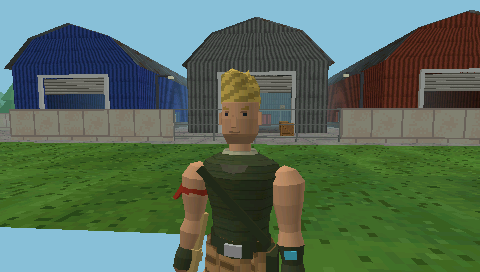

# Jugador: movimiento, física y cámara en tercera persona

Código en `src/game/` (física común en `character.*`, entrada del jugador en `player.*`,
modelo en `character_model.*`) y `src/camera/third_person_camera.*`. Los bots usan la
misma física: ver [BOTS.md](BOTS.md).
Las coordenadas y los ejes son los de [MUNDO.md](MUNDO.md): 1 unidad = 1 m, +Y arriba.

## Estado (`game::CharacterState`, alias `game::Player`)

| Campo        | Significado                                                          |
|--------------|----------------------------------------------------------------------|
| `position`   | Pies del jugador, en coordenadas de mundo (m)                        |
| `velocity`   | m/s                                                                  |
| `yaw`        | Orientación: mira hacia `(-sin yaw, 0, -cos yaw)`; 0 = norte (-Z)    |
| `health`     | Vida (100; los impactos la restan y a 0 el personaje queda eliminado) |
| `jumpState`  | `Grounded` (en suelo), `Rising` (saltando), `Falling` (cayendo)      |
| `airTime`    | Segundos en el aire                                                  |

## Controles en partida

| Botón                      | Acción                                                      |
|----------------------------|-------------------------------------------------------------|
| Stick analógico            | Andar/correr (la velocidad depende de cuánto se incline); la cámara se coloca detrás |
| X                          | Saltar (mantener = salto completo, tocar = salto corto)     |
| L (mantener)               | Apuntar: gira la cámara hacia el bot visible más centrado (cono de 22°, 40 m; giro limitado a 1,6 rad/s) y el stick mueve de lado; sin objetivo, recoloca la cámara detrás y el stick mueve la mira |
| Cruceta ← / →              | Ranura del inventario (en construcción: pieza)              |
| TRIÁNGULO                  | Sacar / guardar el pico (en la página de depuración: cámara libre) |
| R                          | Disparar, golpear con el pico o usar un consumible (ver INVENTARIO.md) |
| CUADRADO                   | Abrir / recoger lo que haya al alcance; si no hay nada, recargar (en construcción: quitar la pared apuntada) |
| X (autobús / caída libre)  | Saltar del autobús / abrir el ala delta (ver BOTIN.md)      |
| CÍRCULO                    | Modo construcción (cruceta: pared, suelo o rampa; R la coloca) |
| L con el francotirador     | Mirilla: primera persona con zoom; el stick apunta más despacio |
| SELECT                     | HUD: partida → depuración → controles → oculto              |
| START                      | Pausa (CONTINUAR / VOLVER AL LOBBY)                         |
| Resultados                 | X lobby, CUADRADO otra partida, CÍRCULO seguir mirando (derrota) |
| L + R + START (1 s)        | Salir                                                       |

**Esquema de la fase 7.** La PSP tiene un solo stick, así que mover y girar comparten el
pulgar izquierdo:
- **Andando:** la cámara se va colocando detrás del jugador (seguimiento a 0,9/s según
  cuánto se incline el stick). Al ir hacia atrás no gira, para poder retroceder.
- **Con L mantenido:** es el modo apuntado. Si hay un enemigo a la vista, lo fija y el
  stick mueve de lado (como en fases anteriores). Si no, el stick gira la cámara y sube o
  baja la mira, y el jugador se queda quieto.
- **Cruceta:** queda libre para elegir objeto (o pieza en construcción).
- **Ayuda de puntería:** corrige pequeños desvíos.

Al mantener L + R + START para salir, apuntar y disparar no tienen otro efecto.

## Movimiento relativo a la cámara

```
adelante = (-sin camYaw, 0, -cos camYaw)        derecha = (cos camYaw, 0, -sin camYaw)
deseo    = adelante * (-stickY) + derecha * stickX        (longitud <= 1)
```

- **Stick:** zona muerta **radial** del 20 %, reescalada para que la salida empiece en 0
  justo al salir de la zona muerta y no pase de 1. Inclinar a medias equivale a andar.
- **Velocidad:** la velocidad horizontal se acerca a `deseo * 5.5 m/s` con aceleración
  limitada:

  | Situación            | Aceleración   |
  |----------------------|---------------|
  | En el suelo          | 45 m/s²       |
  | Frenando             | 60 m/s²       |
  | En el aire (control) | 12 m/s²       |

- **Giro del modelo:** el modelo gira hacia donde se mueve, como mucho 12 rad/s. Al
  disparar o fijar objetivo se orienta con la cámara, para poder andar de lado o de
  espaldas mientras apunta (pose de rifle al frente).
- **Estado en el HUD:** "quieto" por debajo de 0,2 m/s, "andando" por debajo de 3,3 m/s
  y "corriendo" por encima.

## Salto y gravedad

| Parámetro                   | Valor     | Efecto                                         |
|-----------------------------|-----------|------------------------------------------------|
| Gravedad                    | 24 m/s²   | Más que 9,8: salto ágil, "de juego"            |
| Velocidad de salto          | 8 m/s     | Altura máxima ~1,27 m (teórica 1,33 m)         |
| Recorte al soltar X subiendo | ×0,5     | Un toque corto sube ~0,4–0,65 m                |
| Velocidad terminal          | 40 m/s    |                                                |
| Buffer de salto             | 0,12 s    | Pulsar X justo antes de aterrizar también salta |
| Tiempo "coyote"             | 0,10 s    | Margen para saltar tras dejar un borde         |

**Colisiones** (detalle en MUNDO.md):
- **Movimiento horizontal:** el cuerpo (0,7 × 1,8 m) se mueve eje a eje contra las cajas
  AABB que bloquean el movimiento.
- **Escalones:** los de hasta 0,45 m se suben solos (escaleras de las naves).
- **Apoyo:** el personaje se apoya en el techo de caja más alto bajo los pies (cajas,
  altillo) o en el suelo (Y = 0).
- **Caídas y techos:** al caer se buscan las plataformas que estaban por debajo de los
  pies antes del paso, así que no hay tunelado ni a velocidad terminal. Los techos
  detienen el salto.

**Límite del mapa:** ya no hay pared invisible: más allá de ±88 m está la tormenta, que
quita 30 de vida por segundo (ver MUNDO.md). El tope físico, al final del suelo exterior,
está en `X, Z ∈ [-143.5, 143.5]` y no se alcanza vivo.

## Paso fijo, delta time e interpolación

```
cada frame:  dt (medido con sceKernelGetSystemTimeWide)
             -> se ajusta a N pasos exactos si esta a menos del 2 % (VSync a 59.94 Hz)
             -> como mucho 0,1 s por frame (el exceso se descarta)
             -> N pasos de fisica de 1/60 s
             -> estado dibujado = lerp(estado anterior, estado actual, alpha)
```

- **Separación física/render:**
  - `App::update()` lee la entrada, simula los pasos y mueve las cámaras.
  - `App::render()` solo dibuja el estado interpolado.
  - La animación del modelo y el suavizado de la cámara son visuales y usan el `dt` del
    frame con suavizado exponencial (`1 - e^(-k·dt)`), que no depende de los FPS.
- **Límite de desplazamiento:**
  - **Por paso:** la velocidad horizontal está acotada a 5,5 m/s, es decir 9 cm por
    paso.
  - **Por frame:** como mucho 6 pasos, unos 0,55 m corriendo.
  - **Tirones:** si un frame dura más de 0,1 s, el juego se ralentiza en vez de
    teletransportar al jugador. El HUD muestra el tiempo descartado acumulado ("desc").
- **Pulsación de salto:** se guarda en un buffer, así que no se pierde aunque a más de
  60 FPS haya frames sin ningún paso de física.

## Cámara en tercera persona

Desde la fase 4 la cámara está pensada para apuntar:

```
pivote = posición suavizada del jugador + (0, 1.7, 0)
ojo    = pivote + atrás(yaw) · 5·cos(0.24) + (0, 5·sin(0.24), 0)     (~1,2 m por encima)
mira   = dirección (yaw, inclinación), con inclinación de -4° por defecto
```

- **Encuadre:** el ojo está por encima de la cabeza y la mira, casi horizontal, así que
  el personaje queda bajo la mira (como en `Referencias/Referencia gameplay.png`) y la
  mira señala a la altura del pecho de los enemigos.
- **L + stick ↑↓ (sin objetivo):** ajusta la inclinación de la mira entre -29° y +26°. Al
  andar vuelve poco a poco a la de por defecto.
- **Fijar objetivo (L):** encara al bot fijado en horizontal y en vertical.
- **Paredes:** se lanza un raycast del pivote al ojo deseado. Si hay una pared, el ojo se
  acerca al jugador, de modo que dentro de las naves la cámara no queda al otro lado de
  la pared.
- **Suavizado:**

  | Componente | Constante | Nota                                  |
  |------------|-----------|---------------------------------------|
  | Horizontal | k = 12    |                                       |
  | Vertical   | k = 7     | Más lento: el salto no sacude la cámara |
  | Ángulos    | k = 14    |                                       |

  Corriendo, la cámara va unos 0,4 m por detrás y al parar se centra.
- **Altura mínima:** el ojo nunca baja de 0,7 m sobre el suelo (1,155 × plano cercano de
  0,5 m; ver MUNDO.md).

## Modelo del personaje (fase 7)

Se basa en `Referencias/Personaje/` (Jonesy). Lo comparten el jugador y los bots con
cuatro paletas: la del jugador sigue la referencia y los bots usan "comando" (negro y
camuflaje gris), "naranja" (mono, sin camuflaje) y "ranger" (rojo y azul con casco).

**Por qué antes parecía de Roblox y qué ha cambiado:**

| Antes (hasta v0.7.0)                     | Ahora                                                        |
|------------------------------------------|--------------------------------------------------------------|
| 29 cajas de color plano                  | Volúmenes redondeados: anillos elípticos unidos ("loft")     |
| Cabeza cúbica, brazos y piernas rectos   | Cabeza con mandíbula, orejas y nariz; deltoides, bíceps, antebrazos, muslos y botas afinados |
| Sombreado plano por cara                 | Sombreado suave horneado por vértice (luz principal + relleno por detrás) |
| Sin cara                                 | Textura de 64×64 sin filtrar: ojos, cejas, nariz, boca y sombras de la cara |
| Colores lisos                            | La misma textura añade camuflaje, tejido, mechones y suela, teñidos con la paleta |
| 5 piezas, sin codos ni rodillas          | 9 piezas articuladas: codos y rodillas                       |
| Rifle de una mano                        | Rifle sujeto con las dos manos al apuntar                    |

**Proporciones "heroicas" de Fortnite:**
- **Torso:** en V, de 0,33 m de cintura a 0,47 m de pecho.
- **Brazos:** musculosos.
- **Cabeza:** algo grande.
- **Extremos:** manos con guantes grandes y botas altas con pie grande.
- **Altura:** ~1,95 m con el pelo.

**Detalles:**
- **Cabeza:** tupé rubio en onda y casquete por la nuca. El ranger lleva casco con
  visera.
- **Torso:** pañuelo al cuello que cae en pico, correa en bandolera por delante y por
  detrás, cinturón con hebilla y bolsa en la cadera.
- **Brazos:** brazalete rojo con las puntas colgando en el brazo derecho, y protector con
  pantallita azul en el antebrazo izquierdo.
- **Piernas:** dos correas en el muslo, bolsillo lateral, rodilleras y espinilleras
  oliva.

**Lo que lleva en la mano derecha** (pieza del antebrazo intercambiable):
- **Rifle:** cuerpo tostado, cañón, cargador, mira y empuñadura.
- **Pico:** mango y cabeza azulada.
- **Mano vacía:** con un consumible seleccionado.

**Niveles de detalle:**

| Nivel | Lados por anillo | Triángulos | Detalles                     | Se usa para                    |
|-------|------------------|------------|------------------------------|--------------------------------|
| Alto  | 8                | 1292       | Todos                        | Jugador, lobby y bots a < 10 m |
| Bajo  | 4                | 564        | Sin los pequeños (orejas, correas, bolsillos…) | Bots a más de 10 m |

- **Comparación:** el modelo anterior tenía 348 triángulos.
- **Llamadas de dibujo:** una por pieza (9 por personaje), con una sola textura.
- **Medir:** la página de depuración (SELECT) muestra "Tris escenario+personajes".
- **Ajustar:** si con 30 bots bajan los FPS en la PSP, se puede reducir
  `kCharacterLodDistance` (app.cpp) o los lados del nivel alto.

**Animación** (`CharacterAnim`):
- **Al andar:** las piernas se balancean según la velocidad (zancada de 1,6 m) y la
  rodilla se dobla al adelantar la pierna. Los brazos se balancean con el codo flexionado.
- **En el aire:** pose de salto con las rodillas recogidas.
- **Apuntando:** el antebrazo derecho queda horizontal con el rifle al frente y la mano
  izquierda va al guardamanos.
- **Disparo:** retroceso.
- **Impacto:** gesto de dolor.
- **Pico:** golpe desde encima de la cabeza.
- **Reposo:** respiración.
- **Eliminado:** cae de espaldas en 0,45 s.

**Sombra:** bajo los pies hay una sombra circular semitransparente que encoge al subir y
ayuda a leer la altura del salto.

**Revisión:** `make preview` genera tres primeros planos.
- `17_personajes_frente`: las 4 paletas de frente.
- `18_personajes_espalda`: las 4 paletas de espaldas.
- `19_cara_primer_plano`: la cara del jugador.




## Pendiente para fases siguientes

- **Iluminación del modelo:** está horneada en el espacio del modelo, así que la cara
  iluminada gira con el personaje.
- **Sombra:** cuando el personaje salta, se dibuja a la altura del suelo del mapa
  (Y = 0), no sobre cajas ni sobre el altillo.

## Verificación

`make physics-test` ejecuta en el Mac el mismo `PlayerController`, el mismo
`FixedTimestep` y la misma cámara del juego:

- **Direcciones:** comprueba las cuatro, relativas a la cámara.
- **FPS:** la posición final es idéntica a 60, 30, 20, 15 y 144 FPS.
- **Salto:** altura, salto variable y aterrizaje.
- **Suelo:** nunca se atraviesa, tampoco a 10 FPS ni con un tirón de 0,5 s.
- **Cámara:** el seguimiento es suave e independiente de los FPS.
- **Colisiones (fase 4):**
  - las paredes detienen, también en diagonal y en esquinas;
  - no hay tunelado a 10 FPS;
  - se suben escalones de 0,36 m y uno de 0,6 m bloquea;
  - saltando se sube a una caja de 1,2 m;
  - los techos detienen el salto;
  - una caída de 35 m sobre una plataforma de 10 cm aterriza encima.

`make preview` dibuja el modelo y la cámara en tercera persona por software.
