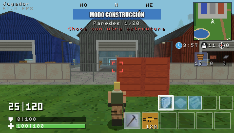
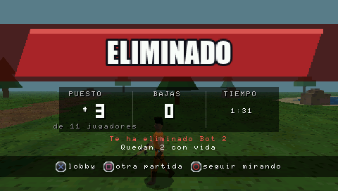

# Presentación, interfaz y sonido (fase 6)

## Flujo de pantallas

```
arranque ──► INICIO DE SESIÓN ──X──► "Conectando..." (1,8 s) ──► LOBBY
                                                                   │
           ┌───────────────── X / CÍRCULO ─── CONTROLES ◄── X ─────┤ CONTROLES
           │                                                       │
           │                                       confirmación ◄─ X ┤ SALIR ──X──► XMB
           ▼                                                       │
         LOBBY ◄───────────────────────────────┐                  X │ JUGAR
                                                │                    ▼
                         X (resultados)         │               CARGA (≥ 2 s)
                         VOLVER AL LOBBY (pausa)│                    │
                                                │                    ▼
     CUADRADO (resultados) ──► CARGA ──► PARTIDA ◄── START ──► PAUSA
                                           │
                     victoria (1 s) ───────┼──── derrota (2,5 s tras caer)
                                           ▼
                                      RESULTADOS ──CÍRCULO (derrota)──► seguir mirando
                                                                       │
                                                  fin de la partida ◄──┘ (vuelven los resultados)
```

- **Arranque:** antes de construir el escenario se dibuja la imagen de inicio de sesión
  con "Cargando..." y "Construyendo el escenario...": la pantalla nunca se queda en negro.
- **Inicio de sesión** (`Recursos/loginscreen.png`): sin usuario ni contraseña (v0.7.2).
  - **En reposo:** bajo el logotipo parpadea "Pulsa (X) para iniciar", con el icono del
    botón.
  - **Al pulsar X:** aparece una barra de carga amarilla con los pasos de una conexión
    simulada ("Conectando...", "Comprobando la versión...", "Cargando el perfil...").
  - **Al terminar:** se entra en el lobby. No hay red ni cuentas.
- **Lobby** (`Referencias/Lobby.png`): barra azul marino con el logotipo y el mapa
  ("POLVORÍN POLVORIENTO"), fondo azul con retícula triangular, suelo de arena y el
  personaje sobre una plataforma octogonal con un halo azul que late. El nombre va sobre
  la cabeza. El stick gira el personaje.
  - **Botones:** JUGAR (amarillo), CONTROLES y SALIR, con la cruceta.
  - **Bots:** ← → sobre JUGAR, de 5 a 30.
  - **SALIR:** pide confirmación.
- **Controles:** la lista completa de controles y una prueba del mando en vivo (botones,
  stick, CPU). Es la misma página que SELECT muestra en partida.
- **Carga** (`Recursos/Loadscreen - match.png`): barra de progreso, un consejo y el mapa.
  La partida se prepara en el segundo frame, con la pantalla ya visible, y se muestra
  como mínimo 2 s.
- **Pausa (START):** CONTINUAR / VOLVER AL LOBBY. La partida no avanza en pausa. START
  no pausa si se están pulsando L o R (es la combinación de salida).
- **Resultados:**
  - **Victoria:** el rótulo "#1 Victory Royale!" de `Recursos/HUD/` y sonido de victoria.
  - **Derrota:** rótulo rojo "ELIMINADO" y sonido de derrota.
  - **Datos:** puesto, bajas, tiempo, quién eliminó al jugador y el ganador (o cuántos
    quedan).
  - **Entrada:** el rótulo entra grande y se asienta en 0,25 s. Durante 0,8 s se ignoran
    los botones, para no saltar la pantalla si se seguía disparando.
  - **Opciones:** X vuelve al lobby y CUADRADO empieza otra partida. En la derrota, si la
    partida sigue, CÍRCULO deja seguir mirando: la cámara sigue a quien eliminó al
    jugador y, al terminar la partida, vuelven los resultados con el ganador.

## HUD de partida

Distribución tomada de `Referencias/Referencia gameplay.png` y `Referencias/HUD/`:

| Zona                 | Contenido                                                                 |
|----------------------|---------------------------------------------------------------------------|
| Arriba izquierda     | Nombre del jugador, FPS y registro de eliminaciones (6 s)                 |
| Arriba centro        | Brújula (N, NO, O… a ±70° de la cámara); en construcción, rótulo "MODO CONSTRUCCIÓN", paredes usadas y motivo si no se puede colocar |
| Arriba derecha       | Minimapa de 76 × 76 px, con norte arriba, la flecha del jugador y el borde de la zona |
| Bajo el minimapa     | Iconos con el tiempo hasta que la zona se cierra, los vivos y las bajas   |
| Derecha              | Materiales: madera (paredes que quedan), ladrillo y metal (0, no se usan) |
| Abajo derecha        | Ranuras de construcción (pared, suelo, rampa; solo la pared funciona) y de armas (pico y SCAR dorada con su reserva) |
| Abajo izquierda      | Munición "30 \| 120" en grande, recarga, escudo (0\|100) y vida (barra verde) |
| Centro               | Mira (roja con objetivo), marcador de impacto, retícula de construcción, números de daño |

- **Minimapa:** una textura de 128 × 128 (1,5 m por texel, 32 KB), generada una vez al
  arrancar a partir de `world::mapColorAt()`: tipo de suelo, tejados de colores de las
  naves, meseta y bosque. Se dibuja una ventana de 96 m alrededor del jugador.
- **Tras caer:** el minimapa y la cámara siguen a quien se está mirando, y arriba aparece
  "ESPECTANDO A …".
- **Elementos gráficos:** iconos, rótulos y rótulos de resultados salen de un único atlas
  (`assets/images/ui_atlas.png`, 512 × 144, 288 KB en RAM), generado por
  `tools/prepare_assets.py` a partir de `Recursos/HUD/` y de la fuente Impact del sistema.
  Los rectángulos están en `src/assets/ui_atlas.h`.
- **Texto:** la fuente 8×8 de `pspDebugScreen`, escrita por CPU sobre el frame ya dibujado.
- **SELECT:** sigue alternando entre partida, depuración (con heap y voces de audio),
  controles y HUD oculto.

## Estilo visual retro

- **Framebuffer de 16 bits** (RGB 565) con el tramado de la GE (`GU_DITHER`): da el color
  de PS1 y usa la mitad de VRAM y de ancho de banda que 32 bits (`kRetro16BitFramebuffer`
  en `gfx/graphics.h`).
- **Texturas originales de 32 × 32** con paleta reducida (`Recursos/Texturas/`, ver
  MUNDO.md), sin filtrar (`GU_NEAREST`).
- **Niebla de distancia** del color del cielo (#8CC2D8) entre 30 y 95 m, que es además la
  distancia de dibujado.
- **Geometría low-poly:** prismas y cajas, con iluminación horneada en el color de
  vértice. El lobby usa las mismas primitivas: plataforma de 8 lados y halo
  semitransparente.
- **Sin efectos caros:** no hay posprocesado, sombras dinámicas ni partículas. Los únicos
  elementos con mezcla alfa son el halo del lobby, la pared fantasma y el HUD.

## Animaciones

`game/character_model.*`, con un coste de unas pocas operaciones por personaje y frame:

- **Andar y correr:** balanceo de piernas y brazos según la velocidad (de fases
  anteriores).
- **Reposo:** respiración (sube y baja 1,2 cm).
- **Disparo:** retroceso de los brazos en cada disparo.
- **Impacto:** el torso se echa hacia atrás al recibir un disparo.
- **Eliminación:** el personaje cae hacia atrás en 0,45 s, en lugar de aparecer tumbado
  de golpe.

Disparos e impactos llegan a las animaciones por los sucesos de la partida (ver más
abajo).

## Ayudas de controles con los botones de la PSP

Todas las referencias a controles se dibujan con los iconos de `Recursos/Texturas PSP`
(X, círculo, cuadrado, triángulo, L, R, START, SELECT, flechas, cruceta y stick).
- **Preparación:** se reducen a 10-13 px y se les añade un contorno claro de 1 px para
  que se lean sobre los paneles oscuros.
- **Dónde aparecen:** inicio de sesión, pie del lobby, confirmación de salida, consejos
  de la pantalla de carga, pausa, resultados, ayudas de construcción, aviso de recargar,
  página de depuración y página de controles. En esta última, además, el mando dibujado
  usa los iconos, que se iluminan al pulsar.
- **Implementación:** `ui::Hint` (botón + texto) con `ui::drawHintIcons()` (iconos, parte
  GU) y `ui::printHints()` (texto, parte CPU). Las dos calculan la misma disposición.

## Sonido

**Formatos compatibles con la PSP, sin bibliotecas externas:**
- **Efectos:** 17 WAV PCM de 16 bits, mono, 22 050 Hz (950 KB en total). Se reproducen
  directamente desde el ejecutable, sin copiarlos.
  - **Sonidos del usuario** (`Recursos/Sonidos/Sonidos Limpios`, convertidos por
    `tools/prepare_assets.py` con `afconvert` y sin el silencio inicial):

    | Sonido                                 | Uso                                                           |
    |----------------------------------------|---------------------------------------------------------------|
    | `scardisparo.wav`                      | Disparo (sustituye al sintetizado)                            |
    | `Fortnite Victory Royale.mp3`          | Victoria (sustituye a la sintonía sintetizada)                |
    | `muertejugadorfortnite.wav`            | Al caer el jugador                                            |
    | `miniescudo.wav`                       | Mientras se bebe una minipoción (se corta si se cancela)      |
    | `pociondeescudogrande.wav`             | Mientras se bebe una poción de escudo (se corta si se cancela) |
    | `Fortnite Running Sound Effect.wav`    | Pasos: se extrae un único paso (0,22 s) y suena en cada pisada |

  - **`avisotormenta`:** suena al entrar en la tormenta del límite del mapa (v0.7.3).
  - **Sin usar todavía:** `Chestopening`, `Fortnite Chest(sin abrir)`, `Opertura ala
    delta`, `Saltar del autobus`, `Fortnite bailemp3` y `Fortnite fusil de tirador de
    cerrojo`. Se quedan en Recursos y no se empaquetan hasta que exista su mecánica
    (cofres, ala delta, autobús, bailes, francotirador).
  - **Sonidos sintetizados** (`tools/generate_sounds.py`): impacto, herido, eliminación,
    pared, pared rota, recarga, menú (mover y aceptar), derrota, pico y curación (vendas
    y botiquín).
- **Pasos:** suenan los del jugador, siempre, y los de los bots a menos de 14 m, con
  volumen y panorama según dónde estén.
- **Música del menú:** `Recursos/Sonidos/main title song.wav`.
  - **Conversión:** pasa de 48 kHz estéreo (22 MB) a 22 050 Hz mono con `afconvert` y a
    IMA ADPCM por bloques (formato propio "IMA1", 4:1). Ocupa 1,2 MB.
  - **Reproducción:** se decodifica bloque a bloque mientras suena y vuelve al principio
    al acabar.
  - **Cuándo suena:** en el inicio de sesión, el lobby, los controles y la carga. No
    suena en la partida.

**Mezclador** (`audio/mixer.*`):
- **Salida:** 8 voces de efectos y la música, en estéreo a 44,1 kHz, por el canal 0 de
  `pspaudiolib` (su propio hilo).
- **Remuestreo:** por vecino más cercano (de 22 050 a 44 100 Hz), barato y con el
  carácter de la época.
- **Sin voces libres:** se reutiliza la voz más antigua.
- **Comunicación con el juego:** una cola circular de un productor y un consumidor, sin
  bloqueos. Si se llenara, el sonido se descarta: el juego nunca espera al audio.

**Sucesos de la partida → sonido** (`game::GameEvent`, `App::processEvents`):

| Suceso                    | Sonido / reacción                                              |
|---------------------------|----------------------------------------------------------------|
| Disparo del jugador       | Disparo al 85 %, retroceso del modelo                          |
| Disparo de un bot         | Disparo con volumen por distancia (hasta 60 m) y panorama respecto a la cámara; retroceso del bot |
| Impacto del jugador       | Marcador de impacto; el bot alcanzado se encoge                |
| Impacto en pared (jugador)| Marcador de impacto al 40 %                                    |
| Jugador herido            | Sonido de herida y gesto de dolor del jugador                  |
| Eliminación por el jugador| Sonido de eliminación                                          |
| Pared construida / quitada| Golpe de madera                                                |
| Pared rota                | Madera rompiéndose, con volumen por distancia                  |
| Recarga                   | Sonido de recarga                                              |
| Caída del jugador         | `muertejugadorfortnite`                                        |
| Empezar / cancelar un consumible | Sonido de beber de la minipoción o de la poción de escudo; se corta al cancelar (`Mixer::stop`) |
| Terminar vendas o botiquín| Sonido de curación                                             |
| Pisada (animación)        | Un paso de la grabación de carrera                             |

## Memoria, carga y estabilidad

**Recursos en el EBOOT** (3.5 MB en total en la v0.7.2):

| Recurso                                 | En el EBOOT | En RAM al usarse                     |
|-----------------------------------------|-------------|--------------------------------------|
| Pantalla de inicio de sesión            | 148 KB PNG  | 272 KB (5551; se libera al entrar al lobby) |
| Pantalla de carga                       | 193 KB PNG  | 272 KB (5551)                        |
| Atlas de interfaz                       | 40 KB PNG   | 288 KB (RGBA)                        |
| Texturas del mundo (16 × 32×32)         | 13 KB PNG   | 32 KB (5551)                         |
| Minimapa                                | (se genera) | 32 KB (5551)                         |
| Efectos de sonido (17)                  | 950 KB      | 0 (se leen del EBOOT)                |
| Música                                  | 1 245 KB    | 8 KB de búfer de bloque              |

- **Imágenes a pantalla completa:** al pasarlas a 16 bits (`loadPngFromMemory(…,
  GU_PSM_5551)`) y recortar el atlas a las filas usadas, la interfaz pasó de ~2,6 MB a
  ~0,8 MB de RAM.
- **VRAM:** dos framebuffers de 16 bits y el búfer de profundidad suman 816 KB de 2 MB.
- **Registro de carga:** `fortnitepsp_log.txt` anota el tiempo y el heap de cada paso de
  la carga, el tamaño de cada imagen, y al empezar y acabar cada partida el tiempo de
  preparación, el heap (y su diferencia con el primer lobby) y los sonidos perdidos.
- **Partidas repetidas:** cada partida nueva reinicia la partida sobre el mismo mundo.
  Las paredes son cajas dinámicas que se retiran, y la rejilla de navegación se restaura.
  Los búferes de la partida (bots, sucesos, trazadoras, números de daño) son de tamaño
  fijo.
- **Comprobación:** `make app-sim` juega 10 partidas seguidas (victorias, derrotas,
  reinicios y abandonos desde la pausa) y comprueba que el heap no crece.

## Verificación en el Mac (`make app-sim`)

`tools/app_sim` compila el **mismo `app::App` que el EBOOT**.
- **Sustituciones:** el mando, el reloj y el audio se simulan, y el dibujo lo hace el
  rasterizador por software de `tools/host/soft_gfx.cpp`, con la fuente 8×8 real de
  `libpspdebug`.
- **Guion de botones:** inicio de sesión, lobby (girar, controles, bots), carga, disparar,
  construir, recargar, páginas del HUD, pausa, derrota, seguir mirando, fin, otra
  partida, victoria, 8 partidas más y salir.
- **Comprobaciones:**
  - cada transición;
  - que la música suena en los menús y los disparos y eliminaciones se oyen;
  - que el heap no crece entre partidas;
  - que no se pierde ningún sonido;
  - el decodificador IMA frente a la música original (SNR 33 dB, sin chasquidos entre
    bloques);
  - el panorama y el límite de voces del mezclador.
- **Salidas:** capturas en `build/app_sim/*.png` (con el color reducido a 16 bits) y los
  primeros 60 s de audio en `build/app_sim/audio.wav`.






Es una simulación: no sustituye a probar en PPSSPP o en una PSP.
- **No hay hardware real:** ni GE, ni VSync, ni hilo de audio.
- **Rendimiento:** solo lo dirán los FPS y el registro en la consola.
